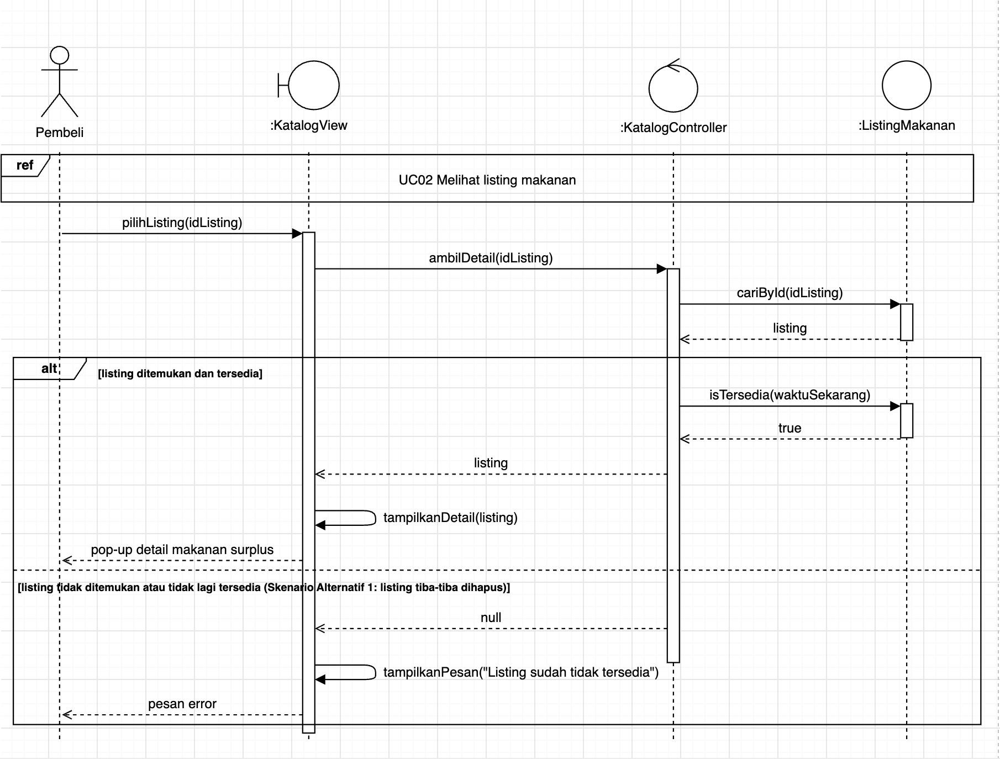
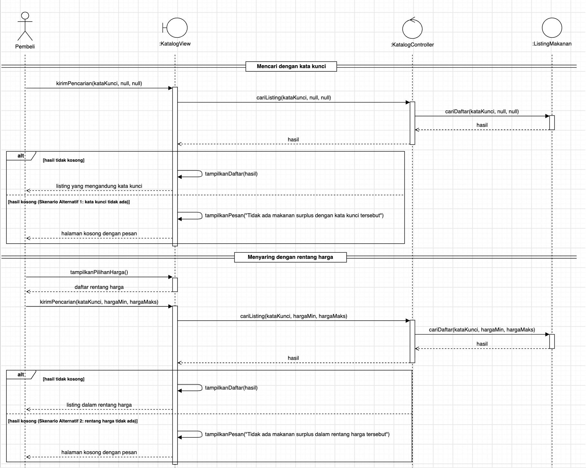

<h1>
IF2150 REKAYASA PERANGKAT LUNAK
 
TUGAS 7
 
DESKRIPSI PERANCANGAN PERANGKAT LUNAK (DPPL)
</h1>
 

## *Food Waste Stop*
### *[Logo Perangkat Lunak]*

### Untuk: *Aurelia Jennifer Gunawan*

Dipersiapkan oleh:
| Informasi | Keterangan |
| --- | --- |
| Kelas | *K02* |
| Kelompok | *G06*  |

| NIM | Nama |
|---|---|
| *13525122* | *Nadia Aulia Syafarani* |
| *13525041* | *Renata Puspanegara Ninagan* |
| *13525119* | *Ghina Emelia Yantes* |
| *13525017* | *Cendra Asih Chairunnisa* |
| *13525089* | *Sherin Felicia Danessa* |
---

## Daftar Perubahan

Daftar berikut mencatat perbedaan rancangan pada DPPL ini terhadap dokumen SKPL dan APL. Dokumen SKPL dan APL tidak diubah, sehingga bagian DPPL yang tercantum di bawah ini menjadi acuan untuk tahap implementasi.

| Revisi | Deskripsi |
| :--- | :--- |
| *A* | *Kelas View dan Controller dari APL (LoginView, KatalogView, ListingView, PembayaranView, RewardView, AuthController, KatalogController, ListingController, PembayaranController, RewardController) serta Validasi dan PaymentGatewayAdapter ditambahkan sebagai kelas perancangan. Method yang merupakan aksi antarmuka (`checkout()`, `bayar()`, `tampilkanListingAll()`, `konfirmasiHapus()`, dsb.) dipindahkan dari kelas Penjual, Pembeli, dan ListingMakanan ke View atau Controller yang bersangkutan.* |
| *B* | *Penjual dan Pembeli tetap menjadi subkelas dari Pengguna (sesuai SKPL), menggantikan atribut `peran` pada komponen Pengguna di APL.* |
| *C* | *Password di-hash di sisi server menggunakan bcrypt setelah dikirim melalui HTTPS. Rancangan ini menggantikan KNF02 SKPL dan LoginView APL yang melakukan hashing SHA-256 di sisi client, karena hash yang dibuat di client akan berfungsi sebagai password itu sendiri.* |
| *D* | *Ditambahkan kelas ItemTransaksi untuk menyimpan listing dan jumlah porsi yang dibeli (SKPL 2.1, aktivitas A07). Transaksi kini berelasi dengan Pembeli dan ItemTransaksi.* |
| *E* | *Ditambahkan kelas Kupon sebagai hasil klaim reward pada UC08 (SKPL 2.4 no. 5). Penggunaan kupon saat pembayaran belum menjadi bagian dari skenario UC05 pada SKPL, sehingga belum direalisasikan pada DPPL ini.* |
| *F* | *ListingMakanan mendapat atribut `batasKedaluwarsa`, `porsi`, `kondisi`, dan `aktif`, serta operasi statis untuk mengambil data listing dari database (`cariById()`, `ambilSemuaTersedia()`, `cariDaftar()`). Penghapusan listing (UC09) dilakukan dengan menonaktifkan listing (soft delete) agar riwayat Transaksi yang merujuk ke listing tersebut tetap utuh.* |
| *G* | *RewardLogin mendapat atribut `tanggalLoginTerakhir` untuk mendeteksi login pertama pada suatu hari. Poin login hanya diberikan kepada Pembeli (sesuai SKPL 2.3).* |
| *H* | *MetodePembayaran pada SKPL dirancang sebagai interface yang direalisasikan oleh PaymentGatewayAdapter untuk berkomunikasi dengan QRIS dummy.* |
| *I* | *ListingController memeriksa bahwa listing yang diedit atau dihapus adalah milik penjual yang sedang login. Pengecekan dan pengurangan stok pada pembayaran dijalankan dalam satu transaksi database dengan penguncian baris (KNF01), dan transaksi yang belum dibayar hingga `batasWaktuBayar` dibatalkan otomatis.* |

---

 

# BAB 1: Pendahuluan

## 1.1 Tujuan Penulisan Dokumen
Dokumen Deskripsi Perancangan Perangkat Lunak (DPPL) ini disusun untuk menjelaskan rancangan aplikasi web Food Waste Stop sebagai bagian dari Tugas Besar mata kuliah Rekayasa Perangkat Lunak (RPL). Dokumen ini menerjemahkan kebutuhan pada SKPL dan arsitektur pada APL menjadi rancangan yang siap diimplementasikan, meliputi lingkungan implementasi, komponen arsitektur, realisasi setiap use case dalam bentuk *sequence diagram* dan diagram kelas, serta matriks kerunutan kelas terhadap use case.

Dokumen ini ditujukan bagi asisten dan/atau dosen mata kuliah RPL sebagai bahan evaluasi, serta bagi anggota kelompok sebagai acuan pada tahap implementasi dan pengujian.

## 1.2 Lingkup Masalah
Industri makanan sering menghasilkan makanan surplus yang masih layak konsumsi tetapi tidak terjual. Makanan tersebut umumnya dibuang sehingga menambah sampah makanan dan menimbulkan kerugian ekonomi bagi pelaku industri. Selain itu, belum tersedia wadah yang memudahkan penjualan makanan surplus kepada konsumen dengan harga terjangkau.

Food Waste Stop merupakan web aplikasi untuk kegiatan jual-beli makanan surplus. Food Waste Stop berfokus menjadi solusi permasalahan sampah makanan industri. Selain itu, Food Waste Stop juga mengurangi kerugian ekonomi industri.

## 1.3 Definisi, Istilah, dan Singkatan

Tabel 1.3. Definisi Istilah dan Singkatan

| Singkatan, Akronim, atau Istilah | Penjelasan |
| :--- | :--- |
| *P/L* | *Singkatan dari Perangkat Lunak, yaitu aplikasi yang memberikan perintah kepada komputer untuk menjalankan tugas tertentu.* |
| *DPPL* | *Singkatan dari Deskripsi Perancangan Perangkat Lunak, yaitu dokumen yang menjelaskan rancangan arsitektur, kelas, dan interaksi antarobjek yang menjadi acuan implementasi perangkat lunak.* |
| *SKPL* | *Singkatan dari Spesifikasi Kebutuhan Perangkat Lunak.* |
| *APL* | *Singkatan dari Arsitektur Perangkat Lunak.* |
| *UC* | *Singkatan dari Use Case.* |
| *MVC* | *Model-View-Controller, yaitu pola arsitektur yang memisahkan tampilan (View), pengendali alur (Controller), dan data serta aturan bisnis (Model).* |
| *QRIS* | *Quick Response Code Indonesian Standard. Pada aplikasi ini digunakan versi dummy sebagai simulasi pembayaran.* |
| *bcrypt* | *Algoritma hashing password yang menggunakan salt dan faktor biaya sehingga tahan terhadap serangan tebak massal.* |
| *Soft delete* | *Penghapusan data dengan menandainya sebagai nonaktif, bukan menghapusnya secara fisik dari database.* |

## 1.4 Aturan Penomoran

Tabel 1.4. Aturan Penomoran

| Hal/Bagian | Penomoran | Keterangan |
| :--- | :--- | :--- |
| *Aktor* | *AXX* | *Pihak di luar sistem (pengguna, perangkat, atau sistem lain) yang berinteraksi dengan sistem* |
| *Use Case* | *UCXX* | *Rangkaian interaksi antara aktor dan sistem untuk mencapai suatu tujuan tertentu* |
| *Kelas* | *CXX* | *Representasi objek dalam sistem yang memiliki atribut dan metode. C01–C07 mengikuti SKPL, sedangkan C08 dan seterusnya adalah kelas baru pada tahap perancangan* |

## 1.5 Referensi
- Dokumen Spesifikasi Kebutuhan Perangkat Lunak (SKPL) Food Waste Stop, K02-G06.
- Dokumen Arsitektur Perangkat Lunak (APL) Food Waste Stop, K02-G06.
- Sommerville, I. (2016). *Software Engineering* (10th ed.). Pearson.
- PowerPoint Rekayasa Perangkat Lunak "Objek, Tanggung Jawab, dan Kolaborasi" & "Stereotipe, Gaya Kendali, dan Lapisan".
- Diagram UML: [https://www.drawio.com/](https://www.drawio.com/), [https://staruml.io/](https://staruml.io/), [https://plantuml.com/](https://plantuml.com/)

## 1.6 Deskripsi Umum Dokumen (Ikhtisar)
BAB 1 berisi pendahuluan dokumen. BAB 2 membahas perancangan arsitektur, meliputi lingkungan implementasi, *style/pattern* acuan, identifikasi komponen, dan model arsitektur. BAB 3 berisi realisasi setiap use case dalam bentuk identifikasi kelas, *sequence diagram*, dan diagram kelas. BAB 4 menyajikan diagram kelas perancangan keseluruhan beserta daftar atribut dan metodenya. BAB 5 berisi matriks kerunutan kelas perancangan terhadap use case.

 

---

# BAB 2: Perancangan Arsitektur

## 2.1 Rancangan Lingkungan Implementasi

Tabel 2.1. Rancangan Lingkungan Implementasi

| Komponen | Spesifikasi |
| :--- | :--- |
| *Operating System* | *Pengembangan: Windows/Linux/macOS. Pengguna: OS apa pun yang memiliki web browser modern (Windows, Linux, macOS, Android, iOS)* |
| *Server* | *Server lokal untuk pengembangan dan demonstrasi* |
| *DBMS* | *PostgreSQL 15* |
| *Bahasa Pemrograman* | *TypeScript (front-end), Python 3.11 (back-end), SQL* |
| *Framework* | *Next.js (React) dengan Node.js v20 untuk proses build; FastAPI untuk back-end* |
| *Development Tools* | *Visual Studio Code, Git dan GitHub, draw.io, PlantUML* |
| *Filing System* | *Data terstruktur disimpan di PostgreSQL. Foto listing (PNG/JPG, maks. 10 MB) disimpan sebagai berkas di direktori penyimpanan server, dan path berkasnya disimpan pada atribut `foto` di ListingMakanan* |

## 2.2 Style/Pattern Arsitektur Acuan

Style yang digunakan adalah client-server: client meminta layanan dan server memproses permintaan tersebut. Pattern yang digunakan adalah MVC, dengan View di sisi client (Next.js), serta Controller dan Model di sisi server (FastAPI). Model membaca dan menyimpan data ke database PostgreSQL.

  

<i>Gambar 1. Arsitektur MVC Food Waste Stop</i>

Alasan pemilihan style/pattern tersebut:
1. Alur Penjual dan Pembeli memiliki tampilan (View) yang terpisah, tetapi dapat memakai logika yang sama (Controller dan Model).
2. Pengguna mengakses sistem dari perangkat yang berbeda, tetapi harus melihat data yang sama, sehingga dibutuhkan server terpusat (client-server).
3. Logika yang membutuhkan keamanan dan konsistensi data, yaitu hashing password (KNF02) dan transaksi pembayaran yang atomik (KNF01), dijalankan di server sehingga tidak dapat dimanipulasi dari sisi client.

## 2.3 Identifikasi Komponen / Modul / Subsistem

Tabel 2.3. Identifikasi Komponen/Modul/Subsistem

| Nama Komponen/Modul/Subsistem | Jenis | Penjelasan |
| :--- | :--- | :--- |
| *LoginView* | *View* | *Menampilkan form login untuk Penjual dan Pembeli, mengirim email dan password ke AuthController melalui HTTPS, menampilkan pesan error, lalu mengarahkan pengguna ke halaman sesuai perannya.* |
| *KatalogView* | *View* | *Menampilkan daftar listing, detail satu listing, serta kolom pencarian dan penyaringan harga kepada Pembeli, dan meneruskan aksinya ke KatalogController.* |
| *ListingView* | *View* | *Menampilkan form tambah dan edit listing, dialog konfirmasi keluar, serta tombol dan dialog konfirmasi hapus listing kepada Penjual, dan meneruskan aksinya ke ListingController.* |
| *PembayaranView* | *View* | *Menampilkan form jumlah porsi, ringkasan pesanan, dan kode QRIS dummy kepada Pembeli, serta meneruskan aksi bayar atau batal ke PembayaranController.* |
| *RewardView* | *View* | *Menampilkan progres poin login, tombol klaim reward, dan kupon yang didapat kepada Pembeli, lalu meneruskan aksi klaim ke RewardController.* |
| *AuthController* | *Controller* | *Memproses login (UC07): meneruskan kredensial ke Validasi, memverifikasi password terhadap hash bcrypt milik Pengguna, lalu jika pengguna adalah Pembeli, memerintahkan RewardLogin mencatat login harian dan menambah poin.* |
| *KatalogController* | *Controller* | *Memproses permintaan melihat listing (UC02), melihat detail (UC03), serta mencari dan menyaring listing (UC04). Hanya listing aktif dengan stok > 0 yang belum melewati batas kedaluwarsa yang dikirim ke View.* |
| *ListingController* | *Controller* | *Memproses penambahan (UC01), pengeditan (UC06), dan penghapusan (UC09) listing. Input diteruskan ke Validasi, dan untuk edit/hapus diperiksa terlebih dahulu bahwa listing adalah milik penjual yang sedang login.* |
| *PembayaranController* | *Controller* | *Memproses checkout dan pembayaran (UC05): membuat Transaksi berstatus menunggu bayar beserta ItemTransaksi, meminta kode QRIS melalui MetodePembayaran, lalu setelah pembayaran dikonfirmasi mengunci dan mengurangi stok ListingMakanan serta menandai Transaksi lunas dalam satu transaksi database (KNF01). Transaksi yang dibatalkan atau melewati batas waktu bayar ditandai batal.* |
| *RewardController* | *Controller* | *Memproses permintaan melihat progres poin dan mengklaim reward (UC08): memeriksa kecukupan poin melalui RewardLogin, mengurangi poin, dan menerbitkan Kupon.* |
| *Pengguna, Penjual, Pembeli* | *Model* | *Merepresentasikan akun pengguna. Pengguna menyimpan data umum (nama, email, hash password), Penjual menambahkan data toko, dan Pembeli menjadi pemilik RewardLogin, Transaksi, dan Kupon.* |
| *ListingMakanan* | *Model* | *Merepresentasikan listing makanan surplus milik Penjual (nama, foto, porsi, kondisi, harga, stok, batas kedaluwarsa, status aktif) beserta aturan ketersediaannya dan operasi untuk mengambil data listing dari database.* |
| *Transaksi, ItemTransaksi* | *Model* | *Merepresentasikan pesanan Pembeli: status, total harga, batas waktu bayar, kode pengambilan, serta daftar listing dan jumlah porsi yang dibeli.* |
| *RewardLogin, Kupon* | *Model* | *Merepresentasikan poin login harian Pembeli beserta tanggal login terakhir, serta kupon potongan harga hasil klaim reward.* |
| *Validasi* | *Pendukung* | *Memvalidasi input listing (field wajib, stok dan harga tidak negatif, foto PNG/JPG maks. 10 MB, batas kedaluwarsa belum lewat) dan input login (format email, password tidak kosong).* |
| *MetodePembayaran, PaymentGatewayAdapter* | *Integrasi Eksternal* | *MetodePembayaran adalah interface pembayaran; PaymentGatewayAdapter merealisasikannya dengan mengirim tagihan ke QRIS dummy, menerima kode QRIS, dan meneruskan status pembayaran ke PembayaranController.* |
| *Database* | *Pendukung* | *Menyimpan seluruh data Model secara persisten pada PostgreSQL 15 dan menjalankan transaksi database yang memenuhi prinsip ACID.* |

## 2.4 Model Arsitektur Perangkat Lunak

### 2.4.1 View Logical View

Logical view dipilih karena memperlihatkan pembagian tanggung jawab antarkomponen MVC dan arah ketergantungannya, sehingga setiap kelas perancangan pada BAB 3 dapat ditelusuri ke komponennya. Setiap View hanya berkomunikasi dengan satu Controller pasangannya melalui HTTPS. Controller memakai Validasi untuk memeriksa input dan memakai Model untuk membaca serta mengubah data. Model menyimpan datanya ke Database. PembayaranController adalah satu-satunya Controller yang berkomunikasi dengan sistem eksternal, yaitu QRIS dummy melalui PaymentGatewayAdapter. AuthController juga memakai Model RewardLogin karena pemberian poin harian terjadi pada saat login.

<i>Gambar 2. Logical View Food Waste Stop</i>

 

---

# BAB 3: Realisasi Use Case

## 3.x Use Case [Nama Use Case contoh]

**ID Use Case:** *[UC0x sesuai SKPL]*  
**Nama Use Case:** *[Nama use case sesuai SKPL]*

### 3.x.1 Identifikasi Kelas

Identifikasi kelas yang terkait dengan use case tersebut. Kelas di tahap perancangan dapat berbeda dengan dengan kelas di tahap analisis. Dapat menggunakan tabel di bawah:

Tabel 3.1. Identifikasi Kelas Use Case [UC0x]

| No | Nama Kelas Perancangan | Nama Kelas Analisis Terkait |
|:--- | :--- | :--- |
| 1 | *[Nama kelas perancangan]* | *[Nama kelas analisis pada SKPL]* |
| 2 | *[Nama kelas perancangan]* | *[Nama kelas analisis pada SKPL]* |

### 3.x.2 Sequence Diagram

Buat *sequence diagram* untuk **setiap skenario use case**, mencakup skenario normal dan alternatif pada subbab 4.4 SKPL. Diagram melibatkan kelas-kelas yang telah diidentifikasi pada SKPL. 

- **Skenario Normal**

<i>Gambar X. Sequence Diagram [UC01]</i>

- **Skenario Alternatif [Nomor]: [Nama Skenario]**

<i>Gambar X. Sequence Diagram [UC01] - [Nama skenario alternatif]</i>

### 3.1.3 Diagram Kelas

Buatlah diagram kelas untuk use case ini yang terdiri atas kelas-kelas dari 3.1.1. **Setiap kelas pada diagram wajib menampilkan atribut dan metode/operasi langsung di dalam kotak kelasnya**, sehingga tidak perlu membuat tabel daftar atribut dan metode per kelas pada subbab ini. Daftar lengkap atribut dan metode seluruh kelas disajikan pada Tabel 4.1 (Bab 4).

<i>Gambar X. Diagram Kelas [Nama Uce Case]</i>

Pada diagram, pastikan:
- Atribut dituliskan beserta visibilitas dan tipe datanya, misalnya `- email: String`.
- Operasi dituliskan beserta visibilitas, parameter, dan tipe kembaliannya, misalnya `+ login(email: String, password: String): Boolean`.
- Relasi antarkelas (asosiasi, agregasi, komposisi, generalisasi, dan dependensi) digambarkan lengkap dengan multiplisitas.
- Semua operasi yang dipanggil pada sequence diagram 3.1.2 (skenario normal dan alternatif) ada pada kelas yang bersangkutan.
- Kelas yang sama dengan kelas di use case lain memakai nama, atribut, dan metode yang konsisten.

BAAAAAAAAAAAAAAAA

## 3.1 Use Case 01

**ID Use Case:** *01*  
**Nama Use Case:** *Menambahkan listing makanan surplus*

### 3.1.1 Identifikasi Kelas

Identifikasi kelas yang terkait dengan use case tersebut. Kelas di tahap perancangan dapat berbeda dengan dengan kelas di tahap analisis. Dapat menggunakan tabel di bawah:

Tabel 3.1. Identifikasi Kelas Use Case [UC01]

| No | Nama Kelas Perancangan | Nama Kelas Analisis Terkait |
|:--- | :--- | :--- |
| 1 | *Penjual* | *idPenjual, toko* |
| 2 | *ListingMakanan* | *idListing, namaMakanan, harga, stok, deskripsi, foto* |

### 3.1.2 Sequence Diagram

Buat *sequence diagram* untuk **setiap skenario use case**, mencakup skenario normal dan alternatif pada subbab 4.4 SKPL. Diagram melibatkan kelas-kelas yang telah diidentifikasi pada SKPL. 

- **Skenario Normal**

<i>Gambar X. Sequence Diagram [UC01]</i>

- **Skenario Alternatif 1:  Verifikasi penambahan makanan gagal**

<i>Gambar X. Sequence Diagram [UC01] - [Verifikasi penambahan makanan gagal]</i>

- **Skenario Alternatif 2:  Percobaan keluar saat penambahan makanan**

<i>Gambar X. Sequence Diagram [UC01] - [Percobaan keluar saat penambahan makanan]</i>

### 3.1.3 Diagram Kelas

Buatlah diagram kelas untuk use case ini yang terdiri atas kelas-kelas dari 3.1.1. **Setiap kelas pada diagram wajib menampilkan atribut dan metode/operasi langsung di dalam kotak kelasnya**, sehingga tidak perlu membuat tabel daftar atribut dan metode per kelas pada subbab ini. Daftar lengkap atribut dan metode seluruh kelas disajikan pada Tabel 4.1 (Bab 4).

<i>Gambar X. Diagram Kelas [Nama Uce Case]</i>

Pada diagram, pastikan:
- Atribut dituliskan beserta visibilitas dan tipe datanya, misalnya `- email: String`.
- Operasi dituliskan beserta visibilitas, parameter, dan tipe kembaliannya, misalnya `+ login(email: String, password: String): Boolean`.
- Relasi antarkelas (asosiasi, agregasi, komposisi, generalisasi, dan dependensi) digambarkan lengkap dengan multiplisitas.
- Semua operasi yang dipanggil pada sequence diagram 3.1.2 (skenario normal dan alternatif) ada pada kelas yang bersangkutan.
- Kelas yang sama dengan kelas di use case lain memakai nama, atribut, dan metode yang konsisten.

## 3.3 Use Case 03

**ID Use Case:** *03*  
**Nama Use Case:** *Melihat detail makanan surplus*

### 3.3.1 Identifikasi Kelas

Tabel 3.3. Identifikasi Kelas Use Case [UC03]

| No | Nama Kelas Perancangan | Nama Kelas Analisis Terkait |
|:--- | :--- | :--- |
| 1 | *KatalogView* | *Pembeli* |
| 2 | *KatalogController* | *ListingMakanan* |
| 3 | *ListingMakanan* | *ListingMakanan* |

### 3.3.2 Sequence Diagram

<i>Gambar X. Sequence Diagram [UC03]</i>

Langkah 1 skenario (membuka halaman listing) sama dengan UC02, sehingga digambarkan sebagai fragmen `ref` ke UC02. Setelah Pembeli memilih satu listing, KatalogView meminta detailnya ke KatalogController, yang mengambil listing melalui `ListingMakanan.cariById()`.

- **Skenario Normal:** cabang `alt [listing ditemukan dan tersedia]`. KatalogController memastikan listing masih tersedia melalui `isTersedia()` (aktif, stok > 0, dan belum melewati batas kedaluwarsa), lalu KatalogView menampilkan detailnya dalam pop-up.
- **Skenario Alternatif 1: Listing yang dipilih tiba-tiba dihapus:** cabang `[listing tidak ditemukan atau tidak lagi tersedia]`. KatalogController mengembalikan `null`, dan KatalogView menampilkan pesan bahwa listing sudah tidak tersedia (KF07).

### 3.3.3 Diagram Kelas

<i>Gambar X. Diagram Kelas Melihat Detail Makanan Surplus</i>

KatalogView bergantung pada KatalogController untuk setiap aksi Pembeli, dan KatalogController membaca nol atau lebih ListingMakanan. Pencarian data listing dilakukan oleh operasi statis ListingMakanan (bergaris bawah), karena Model bertugas mengakses database sesuai APL.

## 3.4 Use Case 04

**ID Use Case:** *04*  
**Nama Use Case:** *Menyaring listing makanan surplus*

### 3.4.1 Identifikasi Kelas

Tabel 3.4. Identifikasi Kelas Use Case [UC04]

| No | Nama Kelas Perancangan | Nama Kelas Analisis Terkait |
|:--- | :--- | :--- |
| 1 | *KatalogView* | *Pembeli* |
| 2 | *KatalogController* | *ListingMakanan* |
| 3 | *ListingMakanan* | *ListingMakanan* |

### 3.4.2 Sequence Diagram

<i>Gambar X. Sequence Diagram [UC04]</i>

Diagram dibagi menjadi dua bagian sesuai langkah skenario: pencarian dengan kata kunci (langkah 1) dan penyaringan dengan rentang harga (langkah 2–3). Kedua bagian memakai alur yang sama, yaitu `kirimPencarian()` → `cariListing()` → `ListingMakanan.cariDaftar()`, yang hanya mengembalikan listing tersedia. Parameter yang tidak diisi Pembeli bernilai `null`, dan kata kunci tetap terbawa saat Pembeli memilih rentang harga.

- **Skenario Normal:** cabang `alt [hasil tidak kosong]` pada kedua bagian.
- **Skenario Alternatif 1: Kata kunci yang dicari tidak ada:** cabang `[hasil kosong]` pada bagian pencarian dengan kata kunci.
- **Skenario Alternatif 2: Rentang harga yang dicari tidak ada:** cabang `[hasil kosong]` pada bagian penyaringan dengan rentang harga.

### 3.4.3 Diagram Kelas

<i>Gambar X. Diagram Kelas Menyaring Listing Makanan Surplus</i>

UC04 memakai kelas yang sama dengan UC03. Operasi yang dipakai pada UC04 adalah `kirimPencarian()`, `tampilkanPilihanHarga()`, `tampilkanDaftar()`, dan `tampilkanPesan()` pada KatalogView, `cariListing()` pada KatalogController, serta `cariDaftar()` pada ListingMakanan.

## 3.5 Use Case 05

**ID Use Case:** *05*  
**Nama Use Case:** *Melakukan Pembayaran*

### 3.5.1 Identifikasi Kelas

Tabel 3.5. Identifikasi Kelas Use Case [UC05]

| No | Nama Kelas Perancangan | Nama Kelas Analisis Terkait |
|:--- | :--- | :--- |
| 1 | *Pembeli* | *Pembeli* |
| 2 | *ListingMakanan* | *ListingMakanan* |
| 3 | *MetodePembayaran* | *MetodePembayaran* |
| 4 | *Transaksi* | *Transaksi* |
| 5 | *ItemTransaksi* | *(kelas baru pada perancangan; rincian listing, jumlah, dan harga satuan dalam Transaksi C06)* |
| 6 | *PembayaranView* | *Pembeli* |
| 7 | *PembayaranController* | *Pembeli* |
| 8 | *PaymentGatewayAdapter* | *MetodePembayaran* |

### 3.5.2 Sequence Diagram

Buat *sequence diagram* untuk **setiap skenario use case**, mencakup skenario normal dan alternatif pada subbab 4.4 SKPL. Diagram melibatkan kelas-kelas yang telah diidentifikasi pada SKPL. 

- **Skenario Normal**

<i>Gambar X. Sequence Diagram [UC05]</i>

- **Skenario Alternatif [Nomor]: [Nama Skenario]**

<i>Gambar X. Sequence Diagram [UC05] - [Nama skenario alternatif]</i>

### 3.5.3 Diagram Kelas

Buatlah diagram kelas untuk use case ini yang terdiri atas kelas-kelas dari 3.1.1. **Setiap kelas pada diagram wajib menampilkan atribut dan metode/operasi langsung di dalam kotak kelasnya**, sehingga tidak perlu membuat tabel daftar atribut dan metode per kelas pada subbab ini. Daftar lengkap atribut dan metode seluruh kelas disajikan pada Tabel 4.1 (Bab 4).

<i>Gambar X. Diagram Kelas Melakukan Pembayaran</i>

## 3.6 Use Case 06

**ID Use Case:** *06*  
**Nama Use Case:** *Mengedit Listing*

### 3.6.1 Identifikasi Kelas

Tabel 3.6. Identifikasi Kelas Use Case [UC06]

| No | Nama Kelas Perancangan | Nama Kelas Analisis Terkait |
|:--- | :--- | :--- |
| 1 | *ListingView* | *Penjual* |
| 2 | *ListingController* | *Penjual* |
| 4 | *Penjual* | *Penjual* |
| 5 | *ListingMakanan* | *ListingMakanan* |
| 6 | *Validasi* | *ListingMakanan* |

### 3.6.2 Sequence Diagram

Buat *sequence diagram* untuk **setiap skenario use case**, mencakup skenario normal dan alternatif pada subbab 4.4 SKPL. Diagram melibatkan kelas-kelas yang telah diidentifikasi pada SKPL. 

- **Skenario Normal**

<i>Gambar X. Sequence Diagram [UC06]</i>

- **Skenario Alternatif [Nomor]: [Nama Skenario]**

<i>Gambar X. Sequence Diagram [UC06] - [Nama skenario alternatif]</i>

### 3.6.3 Diagram Kelas

Buatlah diagram kelas untuk use case ini yang terdiri atas kelas-kelas dari 3.1.1. **Setiap kelas pada diagram wajib menampilkan atribut dan metode/operasi langsung di dalam kotak kelasnya**, sehingga tidak perlu membuat tabel daftar atribut dan metode per kelas pada subbab ini. Daftar lengkap atribut dan metode seluruh kelas disajikan pada Tabel 4.1 (Bab 4).

<i>Gambar X. Diagram Kelas Mengedit Listing</i>

## 3.7 Use Case 07

**ID Use Case:** *07*  
**Nama Use Case:** *Login ke sistem*

### 3.7.1 Identifikasi Kelas

Tabel 3.7. Identifikasi Kelas Use Case [UC07]

| No | Nama Kelas Perancangan | Nama Kelas Analisis Terkait |
|:--- | :--- | :--- |
| 1 | *[Nama kelas perancangan]* | *[Nama kelas analisis pada SKPL]* |
| 2 | *[Nama kelas perancangan]* | *[Nama kelas analisis pada SKPL]* |

### 3.7.2 Sequence Diagram

Buat *sequence diagram* untuk **setiap skenario use case**, mencakup skenario normal dan alternatif pada subbab 4.4 SKPL. Diagram melibatkan kelas-kelas yang telah diidentifikasi pada SKPL. 

- **Skenario Normal**

<i>Gambar X. Sequence Diagram [UC01]</i>

- **Skenario Alternatif [Nomor]: [Nama Skenario]**

<i>Gambar X. Sequence Diagram [UC01] - [Nama skenario alternatif]</i>

### 3.7.3 Diagram Kelas

<i>Gambar X. Diagram Kelas [Nama Uce Case]</i>

## 3.8 Use Case 08

**ID Use Case:** *08*  
**Nama Use Case:** *Mengklaim reward login*

### 3.8.1 Identifikasi Kelas

Tabel 3.8. Identifikasi Kelas Use Case [UC07]

| No | Nama Kelas Perancangan | Nama Kelas Analisis Terkait |
|:--- | :--- | :--- |
| 1 | *[Nama kelas perancangan]* | *[Nama kelas analisis pada SKPL]* |
| 2 | *[Nama kelas perancangan]* | *[Nama kelas analisis pada SKPL]* |
| ... | *...* | *...* |

### 3.8.2 Sequence Diagram

Buat *sequence diagram* untuk **setiap skenario use case**, mencakup skenario normal dan alternatif pada subbab 4.4 SKPL. Diagram melibatkan kelas-kelas yang telah diidentifikasi pada SKPL. 

- **Skenario Normal**

<i>Gambar X. Sequence Diagram [UC01]</i>

- **Skenario Alternatif [Nomor]: [Nama Skenario]**

<i>Gambar X. Sequence Diagram [UC01] - [Nama skenario alternatif]</i>

### 3.8.3 Diagram Kelas

<i>Gambar X. Diagram Kelas [Nama Uce Case]</i>

## 3.9 Use Case 09

**ID Use Case:** *09*  
**Nama Use Case:** *Menghapus makana dari listing*

### 3.9.1 Identifikasi Kelas

Tabel 3.9. Identifikasi Kelas Use Case [UC09]

| No | Nama Kelas Perancangan | Nama Kelas Analisis Terkait |
|:--- | :--- | :--- |
| 1 | *Pengguna* | *verifikasiPassword() getPeran()  bukaListing()* |
| 2 | *Penjual* | *memilikiListing() hapusListing()* |
| 3 | *ListingMakanan* | *cariById() ambilSemuaTersedia() cariDaftar() isTersedia() ubahData() kurangiStok() nonaktifkan()* |
| 4 | *ListingView* | *tampilkanMenuListing() tampilkanKonfirmasiHapus() hapusMakanan()* |
| 4 | *ListingController* | *tambahListing() ubahListing() hapusListing() isPenjual()* |

### 3.9.2 Sequence Diagram

- **Skenario Normal**

<i>Gambar X. Sequence Diagram UC09</i>

- **Skenario Alternatif 01: Toko belum punya listing**

<i>Gambar X. Sequence Diagram UC09 - Toko belum punya listing</i>

### 3.9.3 Diagram Kelas

<i>Gambar X. Diagram Kelas UC09</i>

---

# BAB 4: Diagram Kelas Keseluruhan

## 4.1 Diagram Kelas

<i>Gambar 4.1. Diagram Kelas Perancangan Keseluruhan Food Waste Stop</i>

Relasi antarkelas entity:
- Pengguna (abstrak) ◁— Penjual, Pembeli (generalisasi).
- Penjual 1 — 0..\* ListingMakanan.
- Pembeli 1 — 1 RewardLogin.
- Pembeli 1 — 0..\* Transaksi.
- Pembeli 1 — 0..\* Kupon.
- Transaksi 1 ◆— 1..\* ItemTransaksi (komposisi).
- ItemTransaksi 0..\* — 1 ListingMakanan.
- PaymentGatewayAdapter - - ▷ MetodePembayaran (realisasi).

Relasi kelas View dan Controller berupa dependensi: setiap View bergantung pada Controller pasangannya, dan setiap Controller bergantung pada kelas Model serta Validasi atau MetodePembayaran yang dipakainya, sesuai Gambar 2.

`DataListing` pada parameter metode adalah struktur data input form listing (nama, deskripsi, porsi, kondisi, harga, stok, batasKedaluwarsa, foto), bukan kelas domain. `StatusTransaksi` adalah enumerasi bernilai `MENUNGGU_BAYAR`, `LUNAS`, dan `BATAL`. Operasi bertanda `{static}` digambar bergaris bawah pada diagram kelas.

Tabel 4.1. Daftar Kelas Perancangan Keseluruhan

| ID Kelas | Nama Kelas | Atribut | Metode/Operasi |
| :--- | :--- | :--- | :--- |
| *C01* | *Pengguna* «abstract» | *- idPengguna: Integer - nama: String - email: String - password: String* | *+ verifikasiPassword(password: String): Boolean + getPeran(): String + bukaListing(): listingMakanan* |
| *C02* | *Penjual* | *- namaToko: String - alamatToko: String* | *+ getPeran(): String + memilikiListing(listing: ListingMakanan): Boolean* |
| *C03* | *Pembeli* | *namaAkun: String* | *-* |
| *C04* | *ListingMakanan* | *- idListing: Integer - idPenjual: Integer - namaMakanan: String - deskripsi: String - porsi: String - kondisi: String - foto: String - harga: Integer - stok: Integer - batasKedaluwarsa: DateTime - aktif: Boolean* | *+ cariById(idListing: Integer): ListingMakanan {static} + ambilSemuaTersedia(): List&lt;ListingMakanan&gt; {static} + cariDaftar(kataKunci: String, hargaMin: Integer, hargaMaks: Integer): List&lt;ListingMakanan&gt; {static} + isTersedia(waktu: DateTime): Boolean + ubahData(data: DataListing): void + kurangiStok(jumlah: Integer): void + nonaktifkan(): void* |
| *C05* | *MetodePembayaran* «interface» | *–* | *+ buatTagihan(transaksi: Transaksi): String + cekStatus(idTransaksi: Integer): String* |
| *C06* | *Transaksi* | *- idTransaksi: Integer - idPembeli: Integer - tanggal: DateTime - batasWaktuBayar: DateTime - totalHarga: Integer - status: StatusTransaksi - kodePengambilan: String* | *+ hitungTotal(): Integer + tandaiLunas(): void + batalkan(): void + isLewatBatasWaktu(waktu: DateTime): Boolean* |
| *C07* | *RewardLogin* | *- idReward: Integer - idPembeli: Integer - poinTerkumpul: Integer - tanggalLoginTerakhir: Date - POIN_PER_LOGIN: Integer - POIN_PER_KLAIM: Integer* | *+ catatLogin(tanggal: Date): Boolean + cukupUntukKlaim(): Boolean + kurangiPoin(jumlah: Integer): void* |
| *C08* | *ItemTransaksi* | *- idItem: Integer - idListing: Integer - jumlah: Integer - hargaSatuan: Integer* | *+ hitungSubtotal(): Integer* |
| *C09* | *Kupon* | *- kodeKupon: String - idPembeli: Integer - nilaiPotongan: Integer - berlakuSampai: Date - terpakai: Boolean* | *+ isBerlaku(tanggal: Date): Boolean* |
| *C10* | *LoginView* | *–* | *+ tampilkanForm(): void + kirimKredensial(email: String, password: String): void + tampilkanPesan(pesan: String): void + arahkanKeBeranda(peran: String): void* |
| *C11* | *KatalogView* | *–* | *+ pilihListing(idListing: Integer): void + tampilkanDaftar(daftar: List&lt;ListingMakanan&gt;): void + tampilkanDetail(listing: ListingMakanan): void + tampilkanPilihanHarga(): void + kirimPencarian(kataKunci: String, hargaMin: Integer, hargaMaks: Integer): void + tampilkanPesan(pesan: String): void* |
| *C12* | *ListingView* | *–* | *+ tampilkanFormTambah(): void + tampilkanFormEdit(listing: ListingMakanan): void + kirimListing(data: DataListing): void + tampilkanKonfirmasiKeluar(): Boolean + tampilkanKonfirmasiHapus(listing: ListingMakanan): Boolean + tampilkanPesan(pesan: String): void* |
| *C13* | *PembayaranView* | *–* | *+ tampilkanRingkasan(transaksi: Transaksi): void + tampilkanQRIS(kodeQRIS: String): void + kirimBayar(idTransaksi: Integer): void + kirimBatal(idTransaksi: Integer): void + tampilkanHasil(transaksi: Transaksi): void + tampilkanPesan(pesan: String): void* |
| *C14* | *RewardView* | *–* | *+ tampilkanProgres(poin: Integer, bisaKlaim: Boolean): void + kirimKlaim(): void + tampilkanKupon(kupon: Kupon): void + tampilkanPesan(pesan: String): void* |
| *C15* | *AuthController* | *–* | *+ login(email: String, password: String): Pengguna* |
| *C16* | *KatalogController* | *–* | *+ ambilListingTersedia(): List&lt;ListingMakanan&gt; + ambilDetail(idListing: Integer): ListingMakanan + cariListing(kataKunci: String, hargaMin: Integer, hargaMaks: Integer): List&lt;ListingMakanan&gt;* |
| *C17* | *ListingController* | *–* | *+ tambahListing(idPenjual: Integer, data: DataListing): ListingMakanan + ubahListing(idPenjual: Integer, idListing: Integer, data: DataListing): ListingMakanan + hapusListing(idPenjual: Integer, idListing: Integer): void* |
| *C18* | *PembayaranController* | *- metodePembayaran: MetodePembayaran* | *+ checkout(idPembeli: Integer, idListing: Integer, jumlah: Integer): Transaksi + konfirmasiBayar(idTransaksi: Integer): Transaksi + batalkan(idTransaksi: Integer): void + batalkanLewatBatasWaktu(): void* |
| *C19* | *RewardController* | *–* | *+ lihatProgres(idPembeli: Integer): RewardLogin + klaimReward(idPembeli: Integer): Kupon* |
| *C20* | *Validasi* | *–* | *+ validasiListing(data: DataListing): List&lt;String&gt; + validasiKredensial(email: String, password: String): List&lt;String&gt;* |
| *C21* | *PaymentGatewayAdapter* | *- urlGateway: String* | *+ buatTagihan(transaksi: Transaksi): String + cekStatus(idTransaksi: Integer): String* |

 

---

# BAB 5: Matriks Kerunutan

Tabel 5.1. Matriks Kerunutan Kelas terhadap Use Case

| Kelas | Use Case Terkait |
| :--- | :--- |
| *C01 - Pengguna* | *UC07 - Login ke sistem* |
| *C02 - Penjual* | *UC01 - Menambahkan listing makanan surplus, UC06 - Mengedit listing, UC07 - Login ke sistem, UC09 - Menghapus listing* |
| *C03 - Pembeli* | *UC05 - Melakukan pembayaran, UC07 - Login ke sistem, UC08 - Mengklaim reward login* |
| *C04 - ListingMakanan* | *UC01 - Menambahkan listing makanan surplus, UC02 - Melihat listing makanan surplus, UC03 - Melihat detail makanan surplus, UC04 - Menyaring listing makanan surplus, UC05 - Melakukan pembayaran, UC06 - Mengedit listing, UC09 - Menghapus listing* |
| *C05 - MetodePembayaran* | *UC05 - Melakukan pembayaran* |
| *C06 - Transaksi* | *UC05 - Melakukan pembayaran* |
| *C07 - RewardLogin* | *UC07 - Login ke sistem, UC08 - Mengklaim reward login* |
| *C08 - ItemTransaksi* | *UC05 - Melakukan pembayaran* |
| *C09 - Kupon* | *UC08 - Mengklaim reward login* |
| *C10 - LoginView* | *UC07 - Login ke sistem* |
| *C11 - KatalogView* | *UC02 - Melihat listing makanan surplus, UC03 - Melihat detail makanan surplus, UC04 - Menyaring listing makanan surplus* |
| *C12 - ListingView* | *UC01 - Menambahkan listing makanan surplus, UC06 - Mengedit listing, UC09 - Menghapus listing* |
| *C13 - PembayaranView* | *UC05 - Melakukan pembayaran* |
| *C14 - RewardView* | *UC08 - Mengklaim reward login* |
| *C15 - AuthController* | *UC07 - Login ke sistem* |
| *C16 - KatalogController* | *UC02 - Melihat listing makanan surplus, UC03 - Melihat detail makanan surplus, UC04 - Menyaring listing makanan surplus* |
| *C17 - ListingController* | *UC01 - Menambahkan listing makanan surplus, UC06 - Mengedit listing, UC09 - Menghapus listing* |
| *C18 - PembayaranController* | *UC05 - Melakukan pembayaran* |
| *C19 - RewardController* | *UC08 - Mengklaim reward login* |
| *C20 - Validasi* | *UC01 - Menambahkan listing makanan surplus, UC06 - Mengedit listing, UC07 - Login ke sistem* |
| *C21 - PaymentGatewayAdapter* | *UC05 - Melakukan pembayaran* |
