<h1>
IF2150 REKAYASA PERANGKAT LUNAK
<br>
TUGAS 5
<br>
DESKRIPSI PERANCANGAN PERANGKAT LUNAK (DPPL)
</h1>
<br>

## *Food Waste Stop*


### Untuk: *Aurelia Jennifer Gunawan*

Dipersiapkan oleh:
| Informasi | Keterangan |
| --- | --- |
| Kelas | *K02* |
| Kelompok | *G06*  |

| NIM | Nama |
|---|---|
| *13525122* | *Nadia Aulia Syafarani* |
| *13525041* | *Renata Puspanegara Ninagan* |
| *13525119* | *Ghina Emelia Yantes* |
| *13525017* | *Cendra Asih Chairunnisa* |
| *13525089* | *Sherin Felicia Danessa* |
---

## Daftar Perubahan

| Revisi | Deskripsi |
| :--- | :--- |
| *A* | *Deskripsikan perubahan yang dilakukan dari dokumen sebelumnya pada dokumen ini. Jika tidak terdapat perubahan, harap kosongkan tabel.* |
| *B* |  |
| *C* |  |
| ... |  |

---

<br>

> **Petunjuk pengerjaan:** *[Silahkan hapus bagian ini setelah selesai mengerjakan]*
>
> Dokumen ini melanjutkan **Deskripsi Perancangan Perangkat Lunak**. Gunakan nama, ID, kebutuhan, dan use case yang konsisten dengan kedua dokumen tersebut. Contoh pola ID baru di bawah dapat disesuaikan dengan kesepakatan kelompok, ID yang sudah ada tetap dipertahankan.

<br>

---


# BAB 1: Pendahuluan

## 1.1 Tujuan Penulisan Dokumen
Dokumen Deskripsi Perancangan Perangkat Lunak (DPPL) ini disusun untuk menjelaskan rancangan aplikasi web Food Waste Stop sebagai bagian dari Tugas Besar mata kuliah Rekayasa Perangkat Lunak (RPL). Dokumen ini melanjutkan DPPL sebelumnya yang memuat lingkungan implementasi, arsitektur, realisasi use case, dan diagram kelas keseluruhan, lalu melengkapinya dengan perancangan rinci setiap kelas (operasi, atribut, serta algoritma/*query* untuk operasi penting) serta perancangan antarmuka pengguna. Dengan demikian, kebutuhan pada SKPL dan arsitektur pada APL diterjemahkan menjadi rancangan yang lengkap dan siap diimplementasikan.

Dokumen ini ditujukan bagi asisten dan/atau dosen mata kuliah RPL sebagai bahan evaluasi dan penilaian, serta bagi anggota kelompok sebagai acuan pada tahap implementasi dan pengujian aplikasi.

## 1.2 Lingkup Masalah
Industri makanan sering menghasilkan makanan surplus yang masih layak konsumsi tetapi tidak terjual. Makanan tersebut umumnya dibuang sehingga menambah sampah makanan dan menimbulkan kerugian ekonomi bagi pelaku industri. Selain itu, belum tersedia wadah yang memudahkan penjualan makanan surplus kepada konsumen dengan harga terjangkau.

Food Waste Stop merupakan web aplikasi untuk kegiatan jual-beli makanan surplus. Food Waste Stop berfokus menjadi solusi permasalahan sampah makanan industri. Selain itu, Food Waste Stop juga mengurangi kerugian ekonomi industri.

## 1.3 Definisi, Istilah, dan Singkatan

Tabel 1.3. Definisi Istilah dan Singkatan

| Singkatan, Akronim, atau Istilah | Penjelasan |
| :--- | :--- |
| *P/L* | *Singkatan dari Perangkat Lunak, yaitu aplikasi yang memberikan perintah kepada komputer untuk menjalankan tugas tertentu.* |
| *DPPL* | *Singkatan dari Deskripsi Perancangan Perangkat Lunak, yaitu dokumen yang menjelaskan rancangan arsitektur, kelas, interaksi antarobjek, dan antarmuka yang menjadi acuan implementasi perangkat lunak.* |
| *SKPL* | *Singkatan dari Spesifikasi Kebutuhan Perangkat Lunak.* |
| *APL* | *Singkatan dari Arsitektur Perangkat Lunak.* |
| *UC* | *Singkatan dari Use Case.* |
| *MVC* | *Model-View-Controller, yaitu pola arsitektur yang memisahkan tampilan (View), pengendali alur (Controller), dan data serta aturan bisnis (Model).* |
| *Visibility* | *Tingkat akses atribut atau operasi suatu kelas. Public berarti dapat diakses oleh kelas lain, sedangkan private hanya dapat diakses dari dalam kelas itu sendiri.* |
| *Signature Operasi* | *Penulisan lengkap suatu operasi yang memuat nama operasi, daftar parameter beserta tipenya, dan tipe nilai kembalian.* |
| *Pseudocode* | *Penulisan langkah-langkah algoritma dengan bahasa yang menyerupai bahasa pemrograman tetapi tidak terikat sintaks bahasa tertentu.* |
| *Query* | *Perintah SQL yang digunakan untuk membaca, menambah, mengubah, atau menghapus data pada database.* |
| *Rancangan Antarmuka* | *Gambaran tata letak layar aplikasi beserta komponen dan aksi yang dapat dilakukan pengguna pada layar tersebut.* |
| *QRIS* | *Quick Response Code Indonesian Standard. Pada aplikasi ini digunakan versi dummy sebagai simulasi pembayaran.* |
| *bcrypt* | *Algoritma hashing password yang menggunakan salt dan faktor biaya sehingga tahan terhadap serangan tebak massal.* |
| *Soft delete* | *Penghapusan data dengan menandainya sebagai nonaktif, bukan menghapusnya secara fisik dari database.* |

## 1.4 Aturan Penomoran

Tabel 1.4. Aturan Penomoran

| Hal/Bagian | Penomoran | Keterangan |
| :--- | :--- | :--- |
| *Kebutuhan Fungsional* | *KFXX* | *Layanan atau fungsi yang harus disediakan sistem, yaitu apa yang dapat dilakukan sistem terhadap masukan dan bagaimana sistem berperilaku pada situasi tertentu* |
| *Kebutuhan Non-Fungsional* | *KNFXX* | *Batasan atau kualitas yang harus dipenuhi sistem, seperti performa, keamanan, keandalan, dan kemudahan penggunaan* |
| *Aktor* | *AXX* | *Pihak di luar sistem (pengguna, perangkat, atau sistem lain) yang berinteraksi dengan sistem* |
| *Use Case* | *UCXX* | *Rangkaian interaksi antara aktor dan sistem untuk mencapai suatu tujuan tertentu* |
| *Kelas* | *CXX* | *Representasi objek dalam sistem yang memiliki atribut dan metode. C01–C07 mengikuti SKPL, sedangkan C08 dan seterusnya adalah kelas baru pada tahap perancangan* |
| *Algoritma* | *Algo-CXX-YY* | *Kerangka algoritma (pseudocode) untuk operasi penting pada perancangan rinci kelas (BAB 5), dengan CXX adalah ID kelas pemilik operasi dan YY adalah nomor urut algoritma pada kelas tersebut* |
| *Query* | *Q-CXX-YY* | *Query SQL yang digunakan oleh operasi pada perancangan rinci kelas (BAB 5), dengan CXX adalah ID kelas pemilik operasi dan YY adalah nomor urut query pada kelas tersebut* |
| *Layar Antarmuka* | *SXX* | *Layar/halaman antarmuka aplikasi pada perancangan antarmuka (BAB 6), dinomori berurutan mulai dari S01* |
| *Objek Antarmuka* | *SXX-OYY* | *Objek yang tampil pada suatu layar antarmuka, dengan SXX adalah ID layar dan YY adalah nomor urut objek pada layar tersebut* |

## 1.5 Referensi
- Dokumen Spesifikasi Kebutuhan Perangkat Lunak (SKPL) Food Waste Stop, K02-G06.
- Dokumen Arsitektur Perangkat Lunak (APL) Food Waste Stop, K02-G06.
- Dokumen Deskripsi Perancangan Perangkat Lunak (DPPL) Food Waste Stop versi sebelumnya (Milestone 7), K02-G06.
- Sommerville, I. (2016). *Software Engineering* (10th ed.). Pearson.
- PowerPoint Rekayasa Perangkat Lunak "Objek, Tanggung Jawab, dan Kolaborasi" & "Stereotipe, Gaya Kendali, dan Lapisan".
- Diagram UML: [https://www.drawio.com/](https://www.drawio.com/), [https://staruml.io/](https://staruml.io/), [https://plantuml.com/](https://plantuml.com/)
- Dokumentasi PostgreSQL 15: [https://www.postgresql.org/docs/15/](https://www.postgresql.org/docs/15/)

## 1.6 Deskripsi Umum Dokumen (Ikhtisar)
BAB 1 berisi pendahuluan dokumen, meliputi tujuan, lingkup masalah, definisi, aturan penomoran, dan referensi. BAB 2 membahas perancangan arsitektur, meliputi lingkungan implementasi, *style/pattern* acuan, identifikasi komponen, dan model arsitektur. BAB 3 berisi realisasi setiap use case dalam bentuk identifikasi kelas, *sequence diagram*, dan diagram kelas. BAB 4 menyajikan diagram kelas perancangan keseluruhan beserta daftar atribut dan metodenya. BAB 5 berisi perancangan rinci setiap kelas, meliputi operasi, atribut, serta algoritma/*query* untuk operasi penting. BAB 6 berisi perancangan antarmuka beserta spesifikasi objek pada setiap layar. BAB 7 berisi matriks kerunutan kelas perancangan terhadap use case.

<br>

---

# BAB 2: Perancangan Arsitektur

## 2.1 Rancangan Lingkungan Implementasi

Tabel 2.1. Rancangan Lingkungan Implementasi

| Komponen | Spesifikasi |
| :--- | :--- |
| *Operating System* | *Pengembangan: Windows/Linux/macOS. Pengguna: OS apa pun yang memiliki web browser modern (Windows, Linux, macOS, Android, iOS)* |
| *Server* | *Server lokal untuk pengembangan dan demonstrasi* |
| *DBMS* | *PostgreSQL 15* |
| *Bahasa Pemrograman* | *TypeScript (front-end), Python 3.11 (back-end), SQL* |
| *Framework* | *Next.js (React) dengan Node.js v20 untuk proses build; FastAPI untuk back-end* |
| *Development Tools* | *Visual Studio Code, Git dan GitHub, draw.io, PlantUML* |
| *Filing System* | *Data terstruktur disimpan di PostgreSQL. Foto listing (PNG/JPG, maks. 10 MB) disimpan sebagai berkas di direktori penyimpanan server, dan path berkasnya disimpan pada atribut `foto` di ListingMakanan* |

## 2.2 Style/Pattern Arsitektur Acuan

Style yang digunakan adalah client-server: client meminta layanan dan server memproses permintaan tersebut. Pattern yang digunakan adalah MVC, dengan View di sisi client (Next.js), serta Controller dan Model di sisi server (FastAPI). Model membaca dan menyimpan data ke database PostgreSQL.

<p align="center">
  
</p>
<p align="center">
<i>Gambar 1. Arsitektur MVC Food Waste Stop</i>
</p>

Alasan pemilihan style/pattern tersebut:
1. Alur Penjual dan Pembeli memiliki tampilan (View) yang terpisah, tetapi dapat memakai logika yang sama (Controller dan Model).
2. Pengguna mengakses sistem dari perangkat yang berbeda, tetapi harus melihat data yang sama, sehingga dibutuhkan server terpusat (client-server).
3. Logika yang membutuhkan keamanan dan konsistensi data, yaitu hashing password (KNF02) dan transaksi pembayaran yang atomik (KNF01), dijalankan di server sehingga tidak dapat dimanipulasi dari sisi client.

## 2.3 Identifikasi Komponen / Modul / Subsistem

Tabel 2.3. Identifikasi Komponen/Modul/Subsistem

| Nama Komponen/Modul/Subsistem | Jenis | Penjelasan |
| :--- | :--- | :--- |
| *LoginView* | *View* | *Menampilkan form login untuk Penjual dan Pembeli, mengirim email dan password ke AuthController melalui HTTPS, menampilkan pesan error, lalu mengarahkan pengguna ke halaman sesuai perannya.* |
| *KatalogView* | *View* | *Menampilkan daftar listing, detail satu listing, serta kolom pencarian dan penyaringan harga kepada Pembeli, dan meneruskan aksinya ke KatalogController.* |
| *ListingView* | *View* | *Menampilkan form tambah dan edit listing, dialog konfirmasi keluar, serta tombol dan dialog konfirmasi hapus listing kepada Penjual, dan meneruskan aksinya ke ListingController.* |
| *PembayaranView* | *View* | *Menampilkan form jumlah porsi, ringkasan pesanan, dan kode QRIS dummy kepada Pembeli, serta meneruskan aksi bayar atau batal ke PembayaranController.* |
| *RewardView* | *View* | *Menampilkan progres poin login, tombol klaim reward, dan kupon yang didapat kepada Pembeli, lalu meneruskan aksi klaim ke RewardController.* |
| *AuthController* | *Controller* | *Memproses login (UC07): meneruskan kredensial ke Validasi, memverifikasi password terhadap hash bcrypt milik Pengguna, lalu jika pengguna adalah Pembeli, memerintahkan RewardLogin mencatat login harian dan menambah poin.* |
| *KatalogController* | *Controller* | *Memproses permintaan melihat listing (UC02), melihat detail (UC03), serta mencari dan menyaring listing (UC04). Hanya listing aktif dengan stok > 0 yang belum melewati batas kedaluwarsa yang dikirim ke View.* |
| *ListingController* | *Controller* | *Memproses penambahan (UC01), pengeditan (UC06), dan penghapusan (UC09) listing. Input diteruskan ke Validasi, dan untuk edit/hapus diperiksa terlebih dahulu bahwa listing adalah milik penjual yang sedang login.* |
| *PembayaranController* | *Controller* | *Memproses checkout dan pembayaran (UC05): membuat Transaksi berstatus menunggu bayar beserta ItemTransaksi, meminta kode QRIS melalui MetodePembayaran, lalu setelah pembayaran dikonfirmasi mengunci dan mengurangi stok ListingMakanan serta menandai Transaksi lunas dalam satu transaksi database (KNF01). Transaksi yang dibatalkan atau melewati batas waktu bayar ditandai batal.* |
| *RewardController* | *Controller* | *Memproses permintaan melihat progres poin dan mengklaim reward (UC08): memeriksa kecukupan poin melalui RewardLogin, mengurangi poin, dan menerbitkan Kupon.* |
| *Pengguna, Penjual, Pembeli* | *Model* | *Merepresentasikan akun pengguna. Pengguna menyimpan data umum (nama, email, hash password), Penjual menambahkan data toko, dan Pembeli menjadi pemilik RewardLogin, Transaksi, dan Kupon.* |
| *ListingMakanan* | *Model* | *Merepresentasikan listing makanan surplus milik Penjual (nama, foto, porsi, kondisi, harga, stok, batas kedaluwarsa, status aktif) beserta aturan ketersediaannya dan operasi untuk mengambil data listing dari database.* |
| *Transaksi, ItemTransaksi* | *Model* | *Merepresentasikan pesanan Pembeli: status, total harga, batas waktu bayar, kode pengambilan, serta daftar listing dan jumlah porsi yang dibeli.* |
| *RewardLogin, Kupon* | *Model* | *Merepresentasikan poin login harian Pembeli beserta tanggal login terakhir, serta kupon potongan harga hasil klaim reward.* |
| *Validasi* | *Pendukung* | *Memvalidasi input listing (field wajib, stok dan harga tidak negatif, foto PNG/JPG maks. 10 MB, batas kedaluwarsa belum lewat) dan input login (format email, password tidak kosong).* |
| *MetodePembayaran, PaymentGatewayAdapter* | *Integrasi Eksternal* | *MetodePembayaran adalah interface pembayaran; PaymentGatewayAdapter merealisasikannya dengan mengirim tagihan ke QRIS dummy, menerima kode QRIS, dan meneruskan status pembayaran ke PembayaranController.* |
| *Database* | *Pendukung* | *Menyimpan seluruh data Model secara persisten pada PostgreSQL 15 dan menjalankan transaksi database yang memenuhi prinsip ACID.* |

## 2.4 Model Arsitektur Perangkat Lunak

### 2.4.1 View Logical View

Logical view dipilih karena memperlihatkan pembagian tanggung jawab antarkomponen MVC dan arah ketergantungannya, sehingga setiap kelas perancangan pada BAB 3 dapat ditelusuri ke komponennya. Setiap View hanya berkomunikasi dengan satu Controller pasangannya melalui HTTPS. Controller memakai Validasi untuk memeriksa input dan memakai Model untuk membaca serta mengubah data. Model menyimpan datanya ke Database. PembayaranController adalah satu-satunya Controller yang berkomunikasi dengan sistem eksternal, yaitu QRIS dummy melalui PaymentGatewayAdapter. AuthController juga memakai Model RewardLogin karena pemberian poin harian terjadi pada saat login.

<p align="center">

</p>
<p align="center">
<i>Gambar 2. Logical View Food Waste Stop</i>
</p>

<br>

---


# BAB 3: Realisasi Use Case

## 3.1 Use Case 01

**ID Use Case:** *01*  
**Nama Use Case:** *Menambahkan listing makanan surplus*

### 3.1.1 Identifikasi Kelas

Tabel 3.1. Identifikasi Kelas Use Case [UC01]

| No | Nama Kelas Perancangan | Nama Kelas Analisis Terkait |
|:--- | :--- | :--- |
| 1 | *Penjual* | *idPenjual, toko* |
| 2 | *ListingMakanan* | *idListing, namaMakanan, harga, stok, deskripsi, foto* |

### 3.1.2 Sequence Diagram

- **Skenario Normal**

<p align="center">
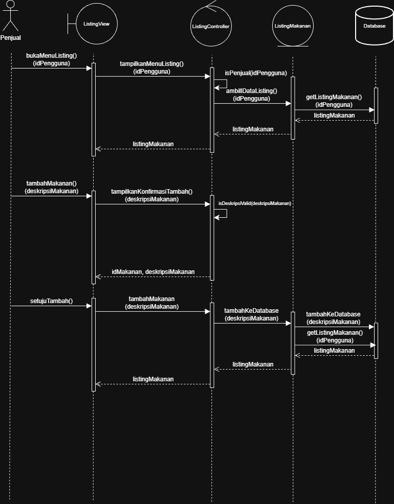
</p>
<p align="center">
<i>Gambar 3.1.1 Sequence Diagram [UC01]</i>
</p>

- **Skenario Alternatif 1:  Verifikasi penambahan makanan gagal**

<p align="center">
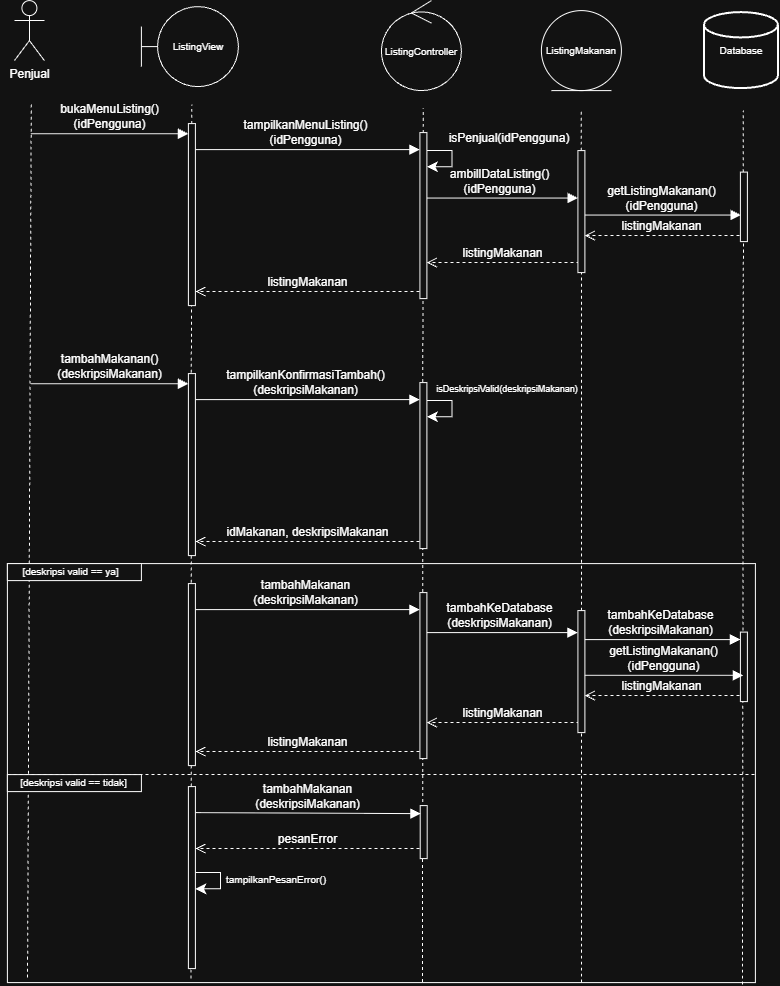
</p>
<p align="center">
<i>Gambar 3.1.2 Sequence Diagram [UC01] - [Verifikasi penambahan makanan gagal]</i>
</p>

- **Skenario Alternatif 2:  Percobaan keluar saat penambahan makanan**

<p align="center">
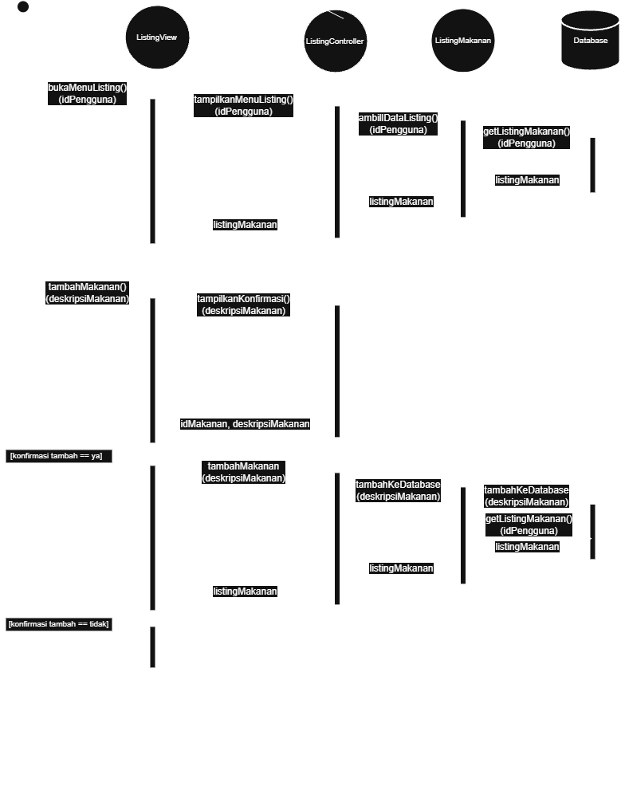
</p>
<p align="center">
<i>Gambar 3.1.3 Sequence Diagram [UC01] - [Percobaan keluar saat penambahan makanan]</i>
</p>

### 3.1.3 Diagram Kelas

<p align="center">
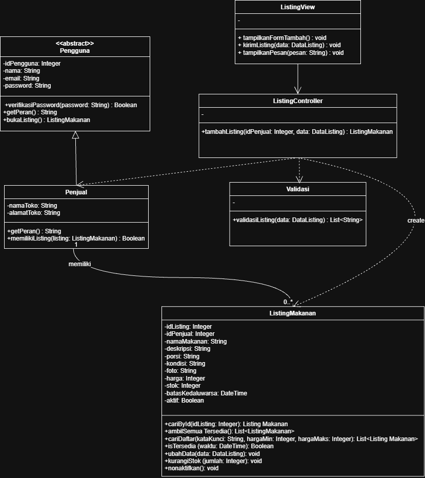
</p>
<p align="center">
<i>Gambar 3.1.4 Diagram Kelas UC02</i>
</p>

## 3.2 Use Case 02

**ID Use Case:** *02*  
**Nama Use Case:** *Melihat listing makanan surplus*

### 3.2.1 Identifikasi Kelas

Tabel 3.1. Identifikasi Kelas Use Case [UC01]

| No | Nama Kelas Perancangan | Nama Kelas Analisis Terkait |
|:--- | :--- | :--- |
| 1 | *Pembeli* | *idPembeli, nama* |
| 2 | *ListingMakanan* | *idListing, namaMakanan, harga, stok, deskripsi, foto* |

### 3.2.2 Sequence Diagram

- **Skenario Normal**

<p align="center">
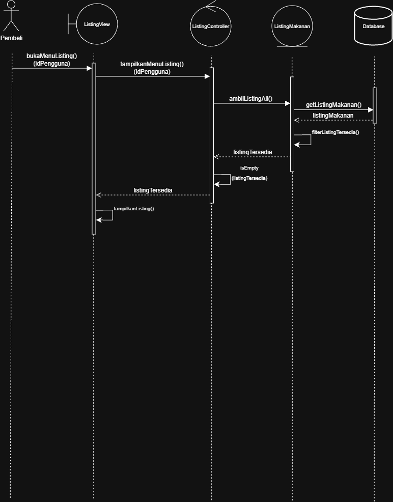
</p>
<p align="center">
<i>Gambar 3.2.1 Sequence Diagram [UC02]</i>
</p>

- **Skenario Alternatif 1:  Listing makanan surplus tidak tersedia**

<p align="center">
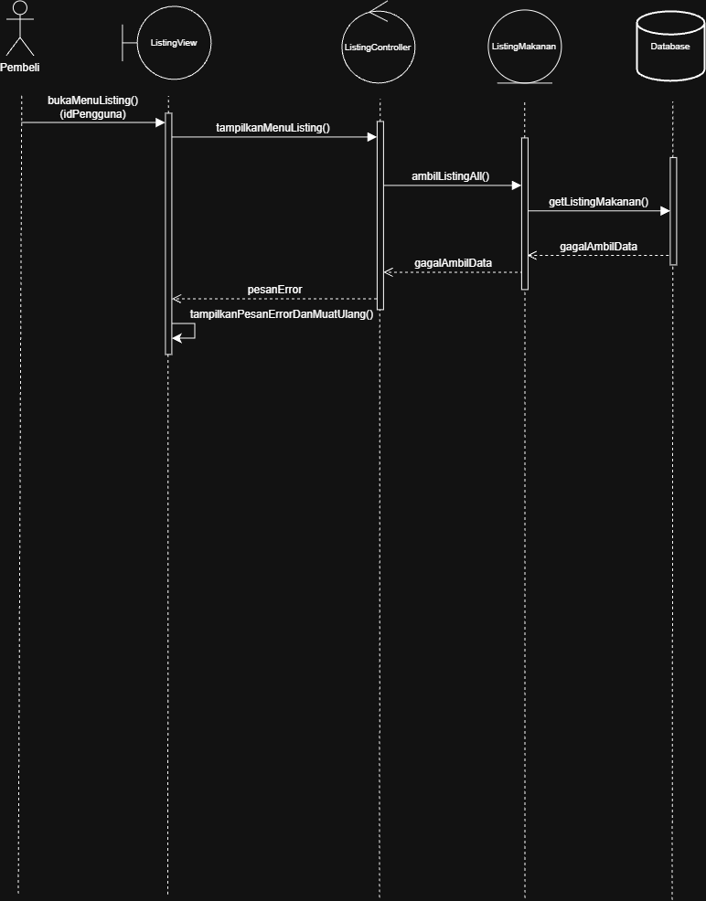
</p>
<p align="center">
<i>Gambar 3.2.2 Sequence Diagram [UC02] - [Verifikasi penambahan makanan gagal]</i>
</p>

### 3.2.3 Diagram Kelas

<p align="center">
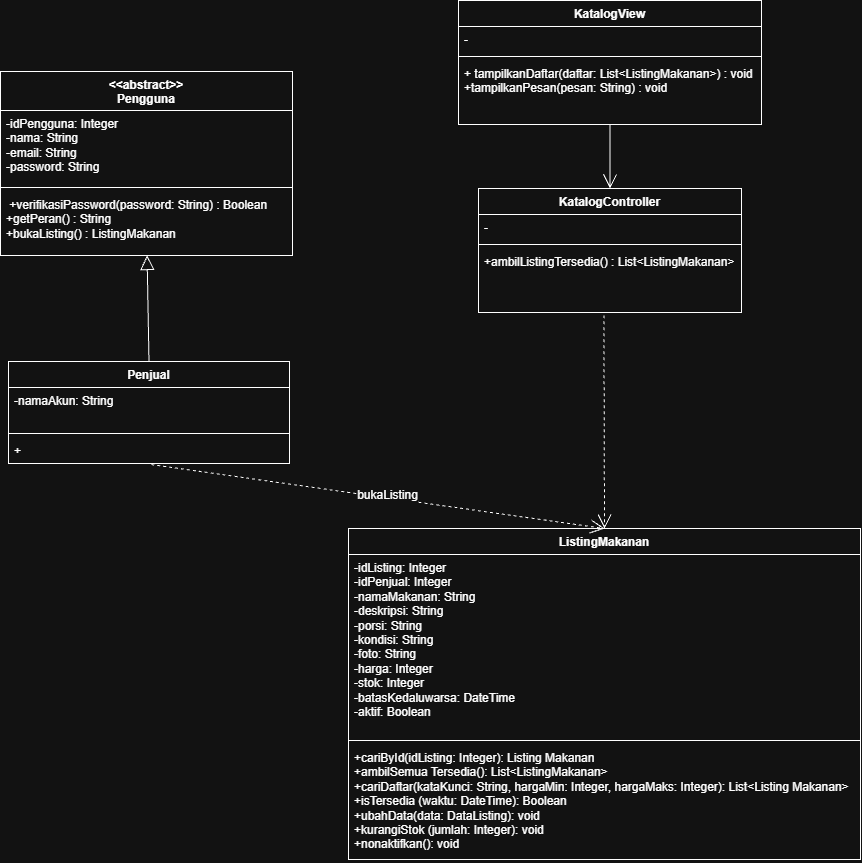
</p>
<p align="center">
<i>Gambar 3.2.3 Diagram Kelas UC02</i>
</p>

## 3.3 Use Case 03

**ID Use Case:** *03*  
**Nama Use Case:** *Melihat detail makanan surplus*

### 3.3.1 Identifikasi Kelas

Tabel 3.3. Identifikasi Kelas Use Case [UC03]

| No | Nama Kelas Perancangan | Nama Kelas Analisis Terkait |
|:--- | :--- | :--- |
| 1 | *KatalogView* | *Pembeli* |
| 2 | *KatalogController* | *ListingMakanan* |
| 3 | *ListingMakanan* | *ListingMakanan* |

### 3.3.2 Sequence Diagram

- **Skenario Normal**

<p align="center">
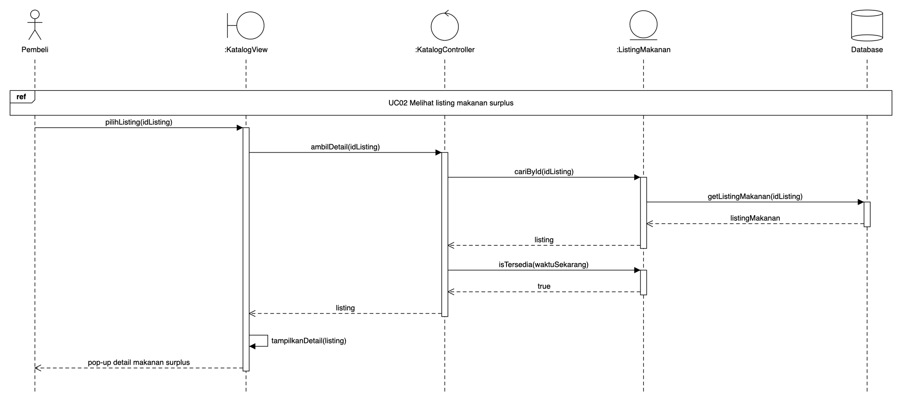
</p>
<p align="center">
<i>Gambar 3.3.1 Sequence Diagram [UC03]</i>
</p>

- **Skenario Alternatif 1: Listing yang dipilih tiba-tiba dihapus**

<p align="center">
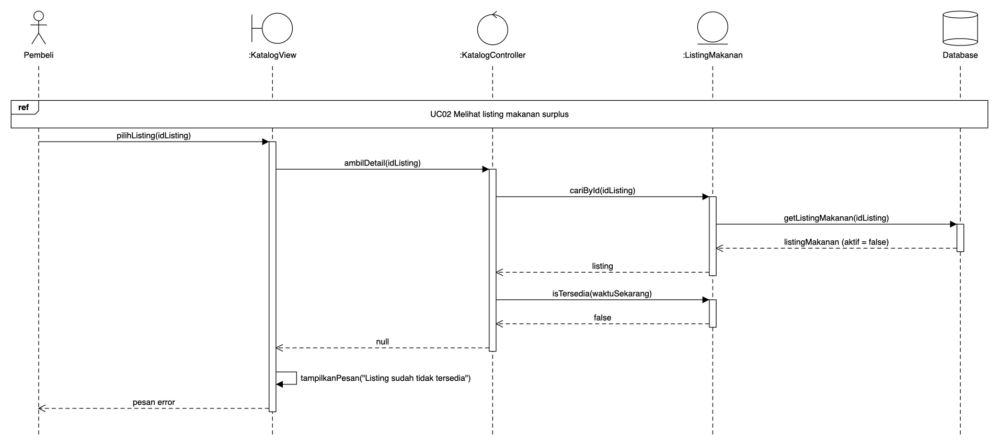
</p>
<p align="center">
<i>Gambar 3.3.2 Sequence Diagram [UC03] - [Listing yang dipilih tiba-tiba dihapus]</i>
</p>

### 3.3.3 Diagram Kelas

<p align="center">
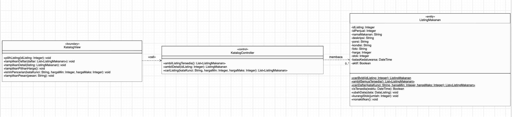
</p>
<p align="center">
<i>Gambar 3.3.3 Diagram Kelas Melihat Detail Makanan Surplus</i>
</p>

## 3.4 Use Case 04

**ID Use Case:** *04*  
**Nama Use Case:** *Menyaring listing makanan surplus*

### 3.4.1 Identifikasi Kelas

Tabel 3.4. Identifikasi Kelas Use Case [UC04]

| No | Nama Kelas Perancangan | Nama Kelas Analisis Terkait |
|:--- | :--- | :--- |
| 1 | *KatalogView* | *Pembeli* |
| 2 | *KatalogController* | *ListingMakanan* |
| 3 | *ListingMakanan* | *ListingMakanan* |

### 3.4.2 Sequence Diagram

- **Skenario Normal**

<p align="center">
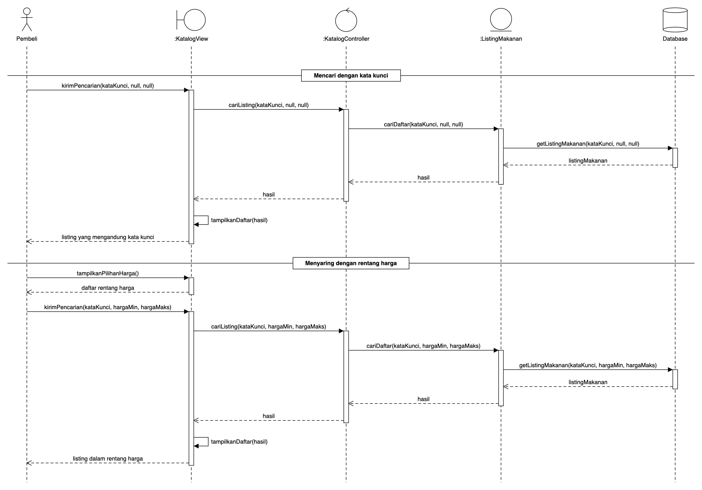
</p>
<p align="center">
<i>Gambar 3.4.1 Sequence Diagram [UC04]</i>
</p>

- **Skenario Alternatif 1: Kata kunci yang dicari tidak ada**

<p align="center">
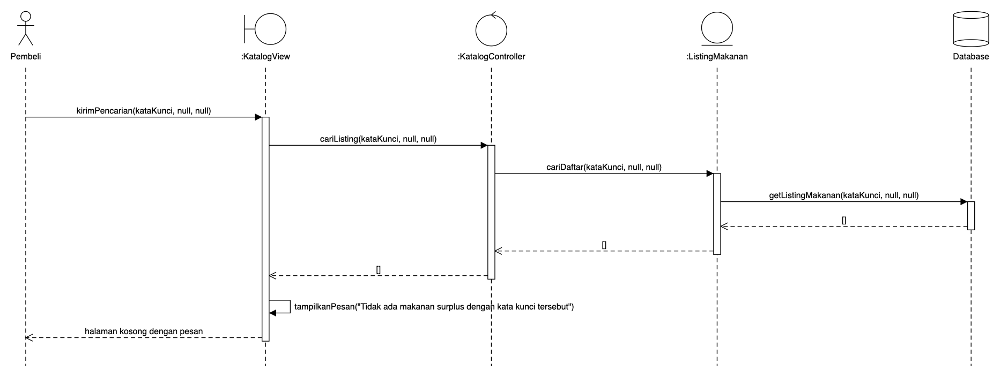
</p>
<p align="center">
<i>Gambar 3.4.2 Sequence Diagram [UC04] - [Kata kunci yang dicari tidak ada]</i>
</p>

- **Skenario Alternatif 2: Rentang harga yang dicari tidak ada**

<p align="center">
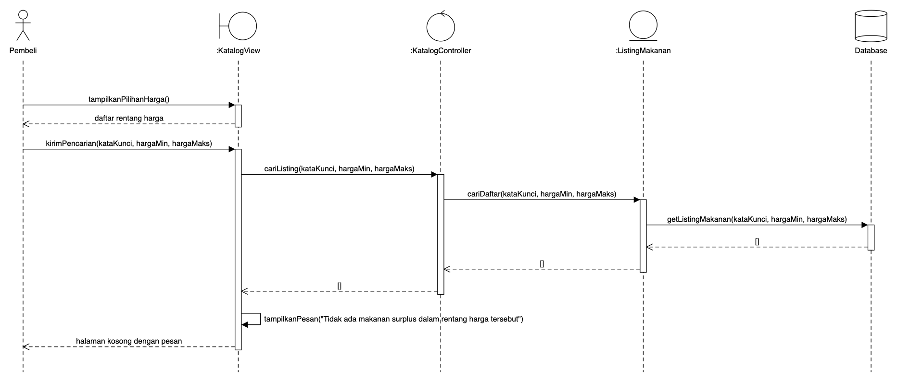
</p>
<p align="center">
<i>Gambar 3.4.3 Sequence Diagram [UC04] - [Rentang harga yang dicari tidak ada]</i>
</p>

### 3.4.3 Diagram Kelas

<p align="center">
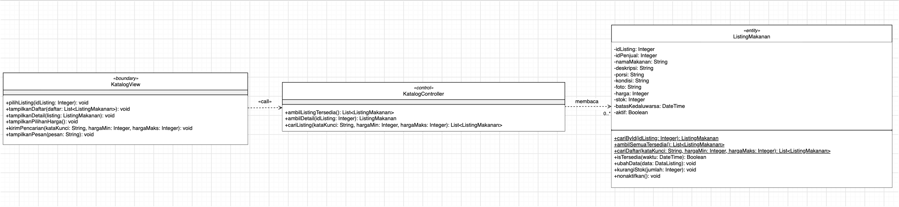
</p>
<p align="center">
<i>Gambar 3.4.4 Diagram Kelas Menyaring Listing Makanan Surplus</i>
</p>

## 3.5 Use Case 05

**ID Use Case:** *05*  
**Nama Use Case:** *Melakukan Pembayaran*

### 3.5.1 Identifikasi Kelas

Tabel 3.5. Identifikasi Kelas Use Case [UC05]

| No | Nama Kelas Perancangan | Nama Kelas Analisis Terkait |
|:--- | :--- | :--- |
| 1 | *Pembeli* | *Pembeli* |
| 2 | *ListingMakanan* | *ListingMakanan* |
| 3 | *MetodePembayaran* | *MetodePembayaran* |
| 4 | *Transaksi* | *Transaksi* |
| 5 | *ItemTransaksi* | *(kelas baru pada perancangan; rincian listing, jumlah, dan harga satuan dalam Transaksi C06)* |
| 6 | *PembayaranView* | *Pembeli* |
| 7 | *PembayaranController* | *Pembeli* |
| 8 | *PaymentGatewayAdapter* | *MetodePembayaran* |


### 3.5.2 Sequence Diagram

- **Skenario Normal**

<p align="center">
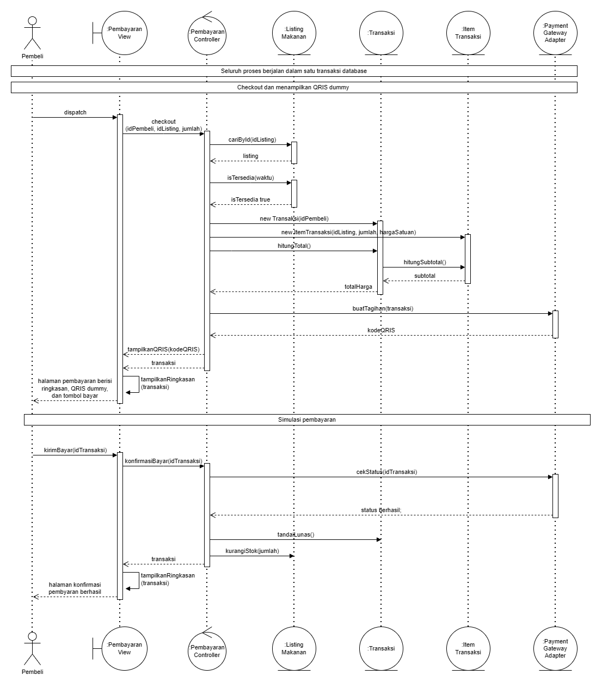
</p>
<p align="center">
<i>Gambar 3.5.1 Sequence Diagram [UC05]</i>
</p>

- **Skenario Alternatif [1]: [Pembeli membatalkan pembayaran]**

<p align="center">
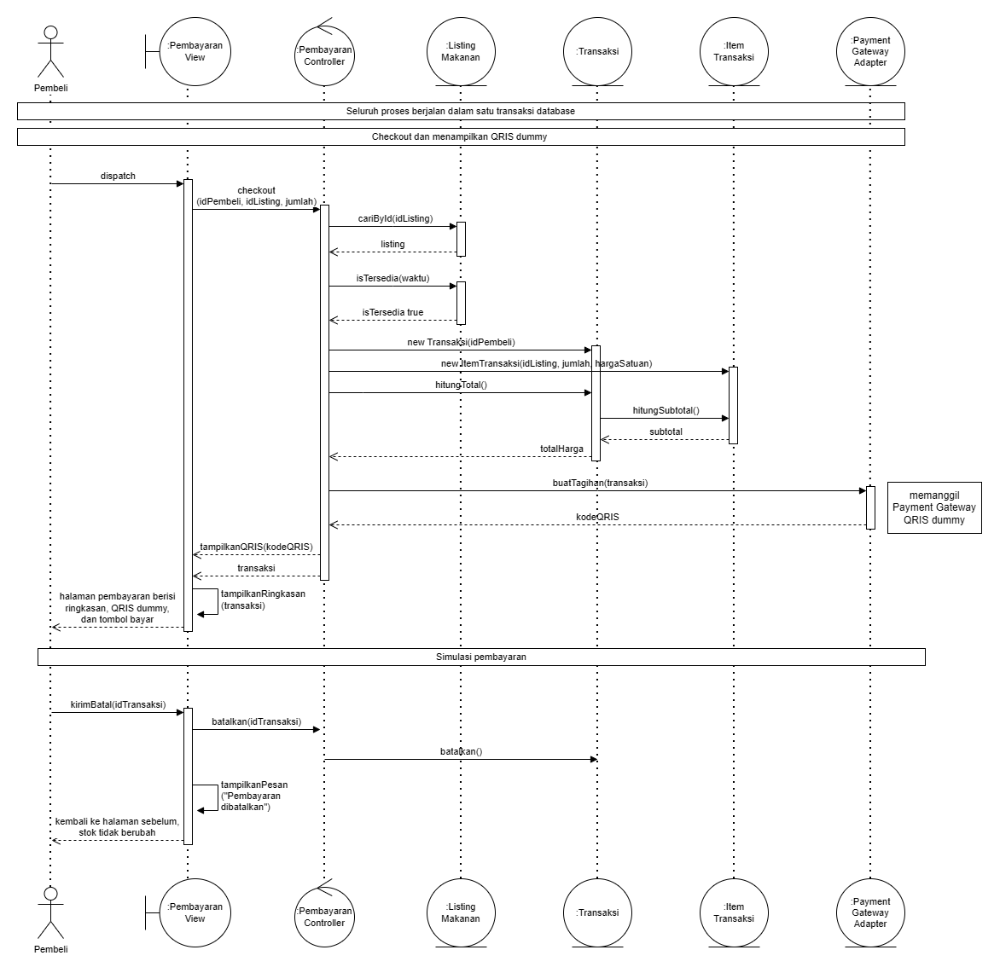
</p>
<p align="center">
<i>Gambar 3.5.2 Sequence Diagram [UC05] - [Pembeli membatalkan pembayaran]</i>
</p>

### 3.5.3 Diagram Kelas

<p align="center">
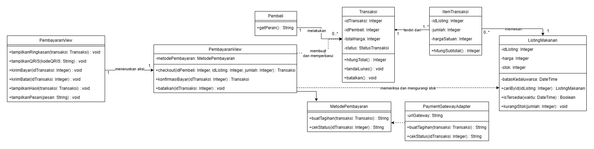
</p>
<p align="center">
<i>Gambar 3.5.2 Diagram Kelas Melakukan Pembayaran</i>
</p>

## 3.6 Use Case 06

**ID Use Case:** *06*  
**Nama Use Case:** *Mengedit Listing*

### 3.6.1 Identifikasi Kelas

Tabel 3.6. Identifikasi Kelas Use Case [UC06]

| No | Nama Kelas Perancangan | Nama Kelas Analisis Terkait |
|:--- | :--- | :--- |
| 1 | *ListingView* | *Penjual* |
| 2 | *ListingController* | *Penjual* |
| 4 | *Penjual* | *Penjual* |
| 5 | *ListingMakanan* | *ListingMakanan* |
| 6 | *Validasi* | *ListingMakanan* |

### 3.6.2 Sequence Diagram

- **Skenario Normal**

<p align="center">
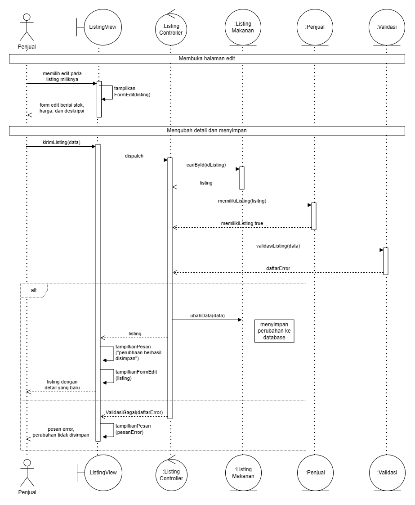
</p>
<p align="center">
<i>Gambar X. Sequence Diagram [UC06]</i>
</p>


### 3.6.3 Diagram Kelas

<p align="center">
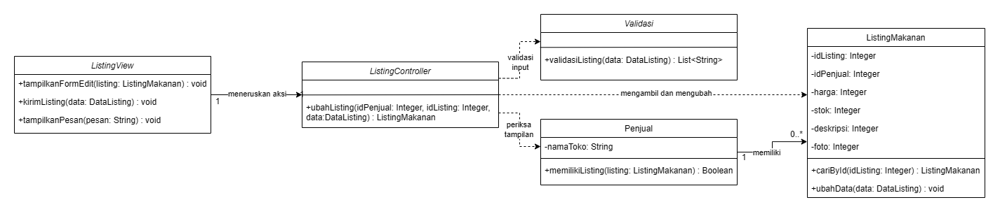
</p>
<p align="center">
<i>Gambar 3.6.3 Diagram Kelas Mengedit Listing</i>
</p>

## 3.7 Use Case 07

**ID Use Case:** *07*  
**Nama Use Case:** *Login ke sistem*

### 3.7.1 Identifikasi Kelas

Tabel 3.7. Identifikasi Kelas Use Case [UC07]

| No | Nama Kelas Perancangan | Nama Kelas Analisis Terkait |
|:--- | :--- | :--- |
| 1 | *LoginView* | *tampilkanForm, kirimKredensial, tampilkanPesan, arahkanKeBeranda* |
| 2 | *AuthController* | *login* |
| 3 | *Validasi* | *validasiKredensial* |
| 4 | *Pengguna* | *verifikasiPassword, getPeran* |
| 5 | *Pembeli* | *getPeran* |
| 6 | *Penjual* | *getPeran* |

### 3.7.2 Sequence Diagram

- **Skenario Normal**

<p align="center">

</p>
<p align="center">
<i>Gambar 3.7.1 Sequence Diagram [UC07]</i>
</p>

- **Skenario Alternatif 1 : Input salah**

<p align="center">

</p>
<p align="center">
<i>Gambar 3.5.2 Sequence Diagram [UC07] - Input salah</i>
</p>

- **Skenario Alternatif 2: Sistem gagal**

<p align="center">

</p>
<p align="center">
<i>Gambar 3.5.2 Sequence Diagram [UC07] - Sistem gagal</i>
</p>


### 3.7.3 Diagram Kelas

<p align="center">

</p>
<p align="center">
<i>Gambar 3.7.2 Diagram Kelas Login Ke Sistem</i>
</p>

## 3.8 Use Case 08

**ID Use Case:** *08*  
**Nama Use Case:** *Mengklaim reward login*

### 3.8.1 Identifikasi Kelas

Tabel 3.8. Identifikasi Kelas Use Case [UC08]

| No | Nama Kelas Perancangan | Nama Kelas Analisis Terkait |
|:--- | :--- | :--- |
| 1 | *RewardView* | *kirimKlaim, tampilkanKupon, tampilkanPesan, tampilkanProgres* |
| 2 | *RewardController* | *klaimReward, lihatProgres, catatLogin* |
| 3 | *RewardLogin* | *cukupUntukKlaim, kurangiPoin* |
| 4 | *Kupon* | *Model data pembuatan objek kupon (isBerlaku)* |
| 5 | *Pembeli* | *getPeran* |

### 3.8.2 Sequence Diagram

- **Skenario Normal**

<p align="center">

</p>
<p align="center">
<i>Gambar 3.8.1 Sequence Diagram [UC08]</i>
</p>

- **Skenario Alternatif 1: Poin tidak mencukupi**

<p align="center">

</p>
<p align="center">
<i>Gambar 3.5.2 Sequence Diagram [UC08] - Poin tidak mencukupi</i>
</p>

- **Skenario Alternatif 2: Sistem gagal**

<p align="center">

</p>
<p align="center">
<i>Gambar 3.5.2 Sequence Diagram [UC08] - Sistem gagal</i>
</p>

### 3.8.3 Diagram Kelas

<p align="center">

</p>
<p align="center">
<i>Gambar 3.8.2 Diagram Kelas Mengklaim Reward Login</i>
</p>

## 3.9 Use Case 09

**ID Use Case:** *09*  
**Nama Use Case:** *Menghapus makana dari listing*

### 3.9.1 Identifikasi Kelas

Tabel 3.9. Identifikasi Kelas Use Case [UC09]

| No | Nama Kelas Perancangan | Nama Kelas Analisis Terkait |
|:--- | :--- | :--- |
| 1 | *Pengguna* | *verifikasiPassword()<br>getPeran() <br>bukaListing()* |
| 2 | *Penjual* | *memilikiListing()<br>hapusListing()* |
| 3 | *ListingMakanan* | *cariById()<br>ambilSemuaTersedia()<br>cariDaftar()<br>isTersedia()<br>ubahData()<br>kurangiStok()<br>nonaktifkan()* |
| 4 | *ListingView* | *tampilkanMenuListing()<br>tampilkanKonfirmasiHapus()<br>hapusMakanan()* |
| 4 | *ListingController* | *tambahListing()<br>ubahListing()<br>hapusListing()<br>isPenjual()* |

### 3.9.2 Sequence Diagram

- **Skenario Normal**

<p align="center">


</p>
<p align="center">
<i>Gambar 3.9.1 Sequence Diagram UC09</i>
</p>

- **Skenario Alternatif 01: Toko belum punya listing**

<p align="center">

</p>
<p align="center">
<i>Gambar 3.9.2 Sequence Diagram UC09 - Toko belum punya listing</i>
</p>

### 3.9.3 Diagram Kelas

<p align="center">


</p>
<p align="center">
<i>Gambar 3.9.2 Diagram Kelas UC09</i>
</p>

---

# BAB 4: Diagram Kelas Keseluruhan

## 4.1 Diagram Kelas

<p align="center">

</p>
<p align="center">
<i>Gambar 4.1. Diagram Kelas Perancangan Keseluruhan Food Waste Stop</i>
</p>

Relasi antarkelas entity:
- Pengguna (abstrak) ◁— Penjual, Pembeli (generalisasi).
- Penjual 1 — 0..\* ListingMakanan.
- Pembeli 1 — 1 RewardLogin.
- Pembeli 1 — 0..\* Transaksi.
- Pembeli 1 — 0..\* Kupon.
- Transaksi 1 ◆— 1..\* ItemTransaksi (komposisi).
- ItemTransaksi 0..\* — 1 ListingMakanan.
- PaymentGatewayAdapter - - ▷ MetodePembayaran (realisasi).

Relasi kelas View dan Controller berupa dependensi: setiap View bergantung pada Controller pasangannya, dan setiap Controller bergantung pada kelas Model serta Validasi atau MetodePembayaran yang dipakainya, sesuai Gambar 2.

`DataListing` pada parameter metode adalah struktur data input form listing (nama, deskripsi, porsi, kondisi, harga, stok, batasKedaluwarsa, foto), bukan kelas domain. `StatusTransaksi` adalah enumerasi bernilai `MENUNGGU_BAYAR`, `LUNAS`, dan `BATAL`. Operasi bertanda `{static}` digambar bergaris bawah pada diagram kelas.

Tabel 4.1. Daftar Kelas Perancangan Keseluruhan

| ID Kelas | Nama Kelas | Atribut | Metode/Operasi |
| :--- | :--- | :--- | :--- |
| *C01* | *Pengguna* «abstract» | *- idPengguna: Integer<br>- nama: String<br>- email: String<br>- password: String* | *+ verifikasiPassword(password: String): Boolean<br>+ getPeran(): String<br>+ bukaListing(): listingMakanan* |
| *C02* | *Penjual* | *- namaToko: String<br>- alamatToko: String* | *+ getPeran(): String<br>+ memilikiListing(listing: ListingMakanan): Boolean* |
| *C03* | *Pembeli* | *namaAkun: String* | *getPeran(): String* |
| *C04* | *ListingMakanan* | *- idListing: Integer<br>- idPenjual: Integer<br>- namaMakanan: String<br>- deskripsi: String<br>- porsi: String<br>- kondisi: String<br>- foto: String<br>- harga: Integer<br>- stok: Integer<br>- batasKedaluwarsa: DateTime<br>- aktif: Boolean* | *+ cariById(idListing: Integer): ListingMakanan {static}<br>+ ambilSemuaTersedia(): List&lt;ListingMakanan&gt; {static}<br>+ cariDaftar(kataKunci: String, hargaMin: Integer, hargaMaks: Integer): List&lt;ListingMakanan&gt; {static}<br>+ isTersedia(waktu: DateTime): Boolean<br>+ ubahData(data: DataListing): void<br>+ kurangiStok(jumlah: Integer): void<br>+ nonaktifkan(): void* |
| *C05* | *MetodePembayaran* «interface» | *–* | *+ buatTagihan(transaksi: Transaksi): String<br>+ cekStatus(idTransaksi: Integer): String* |
| *C06* | *Transaksi* | *- idTransaksi: Integer<br>- idPembeli: Integer<br>- tanggal: DateTime<br>- batasWaktuBayar: DateTime<br>- totalHarga: Integer<br>- status: StatusTransaksi<br>- kodePengambilan: String* | *+ hitungTotal(): Integer<br>+ tandaiLunas(): void<br>+ batalkan(): void<br>+ isLewatBatasWaktu(waktu: DateTime): Boolean* |
| *C07* | *RewardLogin* | *- idReward: Integer<br>- idPembeli: Integer<br>- poinTerkumpul: Integer<br>- tanggalLoginTerakhir: Date<br>- POIN_PER_LOGIN: Integer<br>- POIN_PER_KLAIM: Integer* | *+ catatLogin(tanggal: Date): Boolean<br>+ cukupUntukKlaim(): Boolean<br>+ kurangiPoin(jumlah: Integer): void* |
| *C08* | *ItemTransaksi* | *- idItem: Integer<br>- idListing: Integer<br>- jumlah: Integer<br>- hargaSatuan: Integer* | *+ hitungSubtotal(): Integer* |
| *C09* | *Kupon* | *- kodeKupon: String<br>- idPembeli: Integer<br>- nilaiPotongan: Integer<br>- berlakuSampai: Date<br>- terpakai: Boolean* | *+ isBerlaku(tanggal: Date): Boolean* |
| *C10* | *LoginView* | *–* | *+ tampilkanForm(): void<br>+ kirimKredensial(email: String, password: String): void<br>+ tampilkanPesan(pesan: String): void<br>+ arahkanKeBeranda(peran: String): void* |
| *C11* | *KatalogView* | *–* | *+ pilihListing(idListing: Integer): void<br>+ tampilkanDaftar(daftar: List&lt;ListingMakanan&gt;): void<br>+ tampilkanDetail(listing: ListingMakanan): void<br>+ tampilkanPilihanHarga(): void<br>+ kirimPencarian(kataKunci: String, hargaMin: Integer, hargaMaks: Integer): void<br>+ tampilkanPesan(pesan: String): void* |
| *C12* | *ListingView* | *–* | *+ tampilkanFormTambah(): void<br>+ tampilkanFormEdit(listing: ListingMakanan): void<br>+ kirimListing(data: DataListing): void<br>+ tampilkanKonfirmasiKeluar(): Boolean<br>+ tampilkanKonfirmasiHapus(listing: ListingMakanan): Boolean<br>+ tampilkanPesan(pesan: String): void* |
| *C13* | *PembayaranView* | *–* | *+ tampilkanRingkasan(transaksi: Transaksi): void<br>+ tampilkanQRIS(kodeQRIS: String): void<br>+ kirimBayar(idTransaksi: Integer): void<br>+ kirimBatal(idTransaksi: Integer): void<br>+ tampilkanHasil(transaksi: Transaksi): void<br>+ tampilkanPesan(pesan: String): void* |
| *C14* | *RewardView* | *–* | *+ tampilkanProgres(poin: Integer, bisaKlaim: Boolean): void<br>+ kirimKlaim(): void<br>+ tampilkanKupon(kupon: Kupon): void<br>+ tampilkanPesan(pesan: String): void* |
| *C15* | *AuthController* | *–* | *+ login(email: String, password: String): Pengguna* |
| *C16* | *KatalogController* | *–* | *+ ambilListingTersedia(): List&lt;ListingMakanan&gt;<br>+ ambilDetail(idListing: Integer): ListingMakanan<br>+ cariListing(kataKunci: String, hargaMin: Integer, hargaMaks: Integer): List&lt;ListingMakanan&gt;* |
| *C17* | *ListingController* | *–* | *+ tambahListing(idPenjual: Integer, data: DataListing): ListingMakanan<br>+ ubahListing(idPenjual: Integer, idListing: Integer, data: DataListing): ListingMakanan<br>+ hapusListing(idPenjual: Integer, idListing: Integer): void* |
| *C18* | *PembayaranController* | *- metodePembayaran: MetodePembayaran* | *+ checkout(idPembeli: Integer, idListing: Integer, jumlah: Integer): Transaksi<br>+ konfirmasiBayar(idTransaksi: Integer): Transaksi<br>+ batalkan(idTransaksi: Integer): void<br>+ batalkanLewatBatasWaktu(): void* |
| *C19* | *RewardController* | *–* | *+ lihatProgres(idPembeli: Integer): RewardLogin<br>+ klaimReward(idPembeli: Integer): Kupon* |
| *C20* | *Validasi* | *–* | *+ validasiListing(data: DataListing): List&lt;String&gt;<br>+ validasiKredensial(email: String, password: String): List&lt;String&gt;* |
| *C21* | *PaymentGatewayAdapter* | *- urlGateway: String* | *+ buatTagihan(transaksi: Transaksi): String<br>+ cekStatus(idTransaksi: Integer): String* |

<br>

---

# BAB 5: Perancangan Rinci Kelas

Bagian ini diisi dengan daftar seluruh kelas dalam tabel berikut:

Tabel 5.1. Daftar Kelas Perancangan dan Kelas Analisis Terkait

| No | Nama Kelas Perancangan | Nama Kelas Analisis Terkait |
|:--- | :--- | :--- |
| 1 | *Pengguna* | *verifikasiPassword()<br>getPeran()<br>bukaListing()* |
| 2 | *Penjual* | *Penjual<br>idPenjual, toko<br>getPeran()<br>memilikiListing()<br>hapusListing()* |
| 3 | *Pembeli* | *Pembeli<br>idPembeli, nama<br>getPeran()* |
| 4 | *ListingMakanan* | *ListingMakanan<br>idListing, namaMakanan, harga, stok, deskripsi, foto<br>cariById()<br>ambilSemuaTersedia()<br>cariDaftar()<br>isTersedia()<br>ubahData()<br>kurangiStok()<br>nonaktifkan()* |
| 5 | *KatalogView* | *Pembeli* |
| 6 | *KatalogController* | *ListingMakanan* |
| 7 | *ListingView* | *Penjual<br>tampilkanMenuListing()<br>tampilkanKonfirmasiHapus()<br>hapusMakanan()* |
| 8 | *ListingController* | *Penjual<br>tambahListing()<br>ubahListing()<br>hapusListing()<br>isPenjual()* |
| 9 | *Validasi* | *ListingMakanan<br>validasiKredensial()* |
| 10 | *MetodePembayaran* | *MetodePembayaran* |
| 11 | *Transaksi* | *Transaksi* |
| 12 | *ItemTransaksi* | *(kelas baru pada perancangan; rincian listing, jumlah, dan harga satuan dalam Transaksi C06)* |
| 13 | *PembayaranView* | *Pembeli* |
| 14 | *PembayaranController* | *Pembeli* |
| 15 | *PaymentGatewayAdapter* | *MetodePembayaran* |
| 16 | *LoginView* | *tampilkanForm()<br>kirimKredensial()<br>tampilkanPesan()<br>arahkanKeBeranda()* |
| 17 | *AuthController* | *login()* |
| 18 | *RewardView* | *kirimKlaim()<br>tampilkanKupon()<br>tampilkanPesan()<br>tampilkanProgres()* |
| 19 | *RewardController* | *klaimReward()<br>lihatProgres()<br>catatLogin()* |
| 20 | *RewardLogin* | *cukupUntukKlaim()<br>kurangiPoin()* |
| 21 | *Kupon* | *Model data pembuatan objek kupon (isBerlaku)* |

## 5.1 Kelas Pengguna

**Nama Kelas:** *Pengguna <<abstract>>*  
**ID Kelas:** *C01*

Tabel 5.1.1. Operasi Kelas Pengguna

| Nama Operasi | Visibility (private, public) | Keterangan |
| :--- | :--- | :--- |
| *verifikasiPassword(password: String): Boolean* | *public* | *Mengecek apakah password yang didapat saat login sama dengan hash bcrypt di atribut password* |
| *getPeran(): String* | *public* | *Operasi abstrak untuk mengembalikan peran pengguna* |
| *bukaListing(): ListingMakanan* | *public* | *Mengambil listing milik pengguna penjual* |

Tabel 5.1.2. Atribut Kelas Pengguna

| Nama Atribut | Visibility (private, public) | Tipe |
| :--- | :--- | :--- |
| *idPengguna* | *private* | *Integer* |
| *nama* | *private* | *String* |
| *email* | *private* | *String* |
| *password* | *private* | *String (hash bcrypt)* |

### 5.1.1 Algoritma/Query

**Nama Kelas:** *Pengguna*  
**Nama Operasi:** *verifikasiPassword(password: String): Boolean*  
**ID Algoritma:** *Algo-C01-01*

```text
Function verifikasiPassword(password)
    → bcrypt.cek(password, this.password)
```

### 5.1.2 Algoritma/Query

**Nama Kelas:** *Pengguna*  
**Nama Operasi:** *bukaListing(): ListingMakanan*  
**ID Algoritma:** *Algo-C01-02*

```text
Function bukaListing()
    daftar ← run Q-C01-01 //ambil listing aktif dengan idPenjual = idPengguna
    → daftar
```

Tabel 5.1.3. Query Operasi bukaListing

| No Query | Query | Keterangan |
| :--- | :--- | :--- |
| *Q-C01-01* | *ambilListingAktifPenjual: `SELECT * FROM listing_makanan WHERE id_penjual = :idPengguna AND aktif = TRUE ORDER BY id_listing DESC;`* | *Mengambil seluruh listing aktif milik penjual yang sedang login.* |

## 5.2 Kelas Penjual

**Nama Kelas:** *Penjual*  
**ID Kelas:** *C02*

Tabel 5.2.1. Operasi Kelas Penjual

| Nama Operasi | Visibility (private, public) | Keterangan |
| :--- | :--- | :--- |
| *verifikasiPassword(password: String): Boolean* | *public* | *Memeriksa apakah listing yang diberikan adalah milik penjual ini* |
| *getPeran(): String* | *public* | *Mengembalikan "PENJUAL"* |

Tabel 5.2.2. Atribut Kelas Penjual

| Nama Atribut | Visibility (private, public) | Tipe |
| :--- | :--- | :--- |
| *namaToko* | *private* | *String* |
| *alamatToko* | *private* | *String* |

### 5.2.1 Algoritma/Query

**Nama Kelas:** *Penjual*  
**Nama Operasi:** *verifikasiPassword(password: String):*  
**ID Algoritma:** *Algo-C02-01*

```text
Function memilikiListing(listing)
    → listing.idPenjual = this.idPengguna
```

### 5.2.2 Algoritma/Query

**Nama Kelas:** *Penjual*  
**Nama Operasi:** *getPeran(): String*  
**ID Algoritma:** *Algo-C02-01*

```text
Function getPeran()
    → "PENJUAL"
```

## 5.3 Kelas Pembeli

**Nama Kelas:** *Pembeli*  
**ID Kelas:** *C03*

Tabel 5.3.1. Operasi Kelas Pembeli

| Nama Operasi | Visibility (private, public) | Keterangan |
| :--- | :--- | :--- |
| *getPeran(): String* | *public* | *Mengembalikan "PEMBELI"* |

Tabel 5.3.2. Atribut Kelas Pembeli

| Nama Atribut | Visibility (private, public) | Tipe |
| :--- | :--- | :--- |
| *namaAkun* | *private* | *String* |

### 5.3.1 Algoritma/Query

**Nama Kelas:** *Pembeli*  
**Nama Operasi:** *getPeran(): String*  
**ID Algoritma:** *Algo-C03-01*

```text
Function getPeran()
    → "Pembeli"
```

## 5.4 Kelas ListingMakanan

**Nama Kelas:** *ListingMakanan*  
**ID Kelas:** *C04*

Tabel 5.4.1. Operasi Kelas ListingMakanan

| Nama Operasi | Visibility (private, public) | Keterangan |
| :--- | :--- | :--- |
| *cariById(idListing: Integer): ListingMakanan {static}* | *public* | *Mengambil satu listing dari database berdasarkan id* |
| *ambilSemuaTersedia(): List<ListingMakanan> {static}* | *public* | *	Mengambil seluruh listing yang aktif, berstok > 0, dan belum melewati batas kedaluwarsa* |
| *cariDaftar(kataKunci: String, hargaMin: Integer, hargaMaks: Integer): List<ListingMakanan> {static}* | *public* | *Mengambil listing tersedia yang namanya memuat kata kunci dan harganya berada dalam rentang* |
| *isTersedia(waktu: DateTime): Boolean* | *public* | *Menentukan apakah listing dapat dibeli pada waktu tertentu* |
| *ubahData(data: DataListing): void* | *public* | *Memperbarui nama, deskripsi, porsi, kondisi, harga, stok, batas kedaluwarsa, dan foto pada listing* |
| *kurangiStok(jumlah: Integer): void* | *public* | *Mengurangi stok sejumlah porsi yang dibeli* |
| *nonaktifkan(): void* | *public* | *Menandai listing sebagai tidak aktif* |

Tabel 5.4.2. Atribut Kelas ListingMakanan

| Nama Atribut | Visibility (private, public) | Tipe |
| :--- | :--- | :--- |
| *idListing* | *private* | *Integer* |
| *idPenjual* | *private* | *Integer* |
| *namaMakanan* | *private* | *String* |
| *deskripsi* | *private* | *String* |
| *porsi* | *private* | *String* |
| *kondisi* | *private* | *String* |
| *foto* | *private* | *String* |
| *harge* | *private* | *Integer* |
| *stok* | *private* | *Integer* |
| *batasKedaluwarsa* | *private* | *DateTime* |
| *aktif* | *private* | *Boolean* |

### 5.4.1 Algoritma/Query

**Nama Kelas:** *ListingMakanan*  
**Nama Operasi:** *cariById(idListing: Integer): ListingMakanan {static}*  
**ID Algoritma:** *Algo-C04-01*

```text
Function cariById(idListing)
    baris ← ambil listing berdasarkan idListing // Q-C04-01
    if baris kosong then
        → NULL
    ListingMakanan → baris.toListingMakanan
    → ListingMakanan
```

Tabel 5.4.3. Query Operasi cariById

| No Query | Query | Keterangan |
| :--- | :--- | :--- |
| *Q-C04-01* | *ambilListingById: `SELECT * FROM listing_makanan WHERE id_listing = @idListing;`* | *Mengambil satu listing berdasarkan id* |

### 5.4.2 Algoritma/Query

**Nama Kelas:** *ListingMakanan*  
**Nama Operasi:** *ambilSemuaTersedia(): List<ListingMakanan> {static}*  
**ID Algoritma:** *Algo-C04-02*

```text
Function ambilSemuaTersedia()
    hasil ← ambil seluruh listing tersedia // Q-C04-02
    daftar ← daftar kosong
    FOR each baris IN hasil
        tambahkan ListingMakanan dari baris ke daftar
    → daftar
```

Tabel 5.4.4. Query Operasi ambilSemuaTersedia

| No Query | Query | Keterangan |
| :--- | :--- | :--- |
| *Q-C04-02* | *ambilListingTersedia: `SELECT * FROM listing_makanan WHERE aktif = TRUE AND stok > 0 AND batas_kedaluwarsa > NOW() ORDER BY batas_kedaluwarsa ASC;`* | *Mengambil listing yang dapat dibeli* |

### 5.4.3 Algoritma/Query

**Nama Kelas:** *ListingMakanan*  
**Nama Operasi:** *cariDaftar(kataKunci, hargaMin, hargaMaks): List<ListingMakanan>*  
**ID Algoritma:** *Algo-C04-03*

```text
Function cariDaftar(kataKunci, hargaMin, hargaMaks)
    hasil ← cari listing tersedia sesuai kata kunci dan rentang harga   // Q-C04-03
    daftar ← daftar kosong
    FOR each baris IN hasil
        tambahkan ListingMakanan dari baris ke daftar
    → daftar
```

Tabel 5.4.5. Query Operasi cariDaftar

| No Query | Query | Keterangan |
| :--- | :--- | :--- |
| *Q-C04-02* | *cariListingTersedia: `SELECT * FROM listing_makanan WHERE aktif = TRUE AND stok > 0 AND batas_kedaluwarsa > NOW() AND (@kataKunci IS NULL OR LOWER(nama_makanan) LIKE '%' or LOWER(@kataKunci) or '%') AND (@hargaMin IS NULL OR harga >= @hargaMin) AND (@hargaMaks IS NULL OR harga <= @hargaMaks) ORDER BY batas_kedaluwarsa ASC;`* | *Mencari nama dan menyaring rentang harga* |

### 5.4.4 Algoritma/Query

**Nama Kelas:** *ListingMakanan*  
**Nama Operasi:** *isTersedia(waktu: DateTime): Boolean*  
**ID Algoritma:** *Algo-C04-04*

```text
Function isTersedia(waktu)
    → aktif = TRUE and stok > 0 and waktu < batasKedaluwarsa
```

### 5.4.5 Algoritma/Query

**Nama Kelas:** *ListingMakanan*  
**Nama Operasi:** *ubahData(data: DataListing): void*  
**ID Algoritma:** *Algo-C04-05*

```text
Function ubahData(data)
    namaMakanan ← data.namaMakanan
    deskripsi ← data.deskripsi
    porsi ← data.porsi
    kondisi ← data.kondisi
    harga ← data.harga
    stok ← data.stok
    batasKedaluwarsa ← data.batasKedaluwarsa
    if data.foto ≠ NULL then
        foto ← data.foto
    simpan perubahan listing // Q-C04-04
```

Tabel 5.4.6. Query Operasi ubahData

| No Query | Query | Keterangan |
| :--- | :--- | :--- |
| *Q-C04-04* | *perbaruiDataListing: `UPDATE listing_makanan SET nama_makanan = @nama, deskripsi = @deskripsi, porsi = @porsi, kondisi = @kondisi, harga = @harga, stok = @stok, batas_kedaluwarsa = @batas, foto = @foto WHERE id_listing = @idListing;`* | *Menyimpan perubahan data listing* |

### 5.4.6 Algoritma/Query

**Nama Kelas:** *ListingMakanan*  
**Nama Operasi:** *kurangiStok(jumlah: Integer): void*  
**ID Algoritma:** *Algo-C04-06*

```text
Function kurangiStok(jumlah)
    if jumlah ≤ 0 or jumlah > stok then
        → error "Stok tidak mencukupi"
    stok ← stok - jumlah
```

### 5.4.7 Algoritma/Query

**Nama Kelas:** *ListingMakanan*  
**Nama Operasi:** *nonaktifkan(): void*  
**ID Algoritma:** *Algo-C04-05*

```text
Function nonaktifkan()
    aktif ← FALSE
    simpan perubahan status listing // Q-C04-05
```

Tabel 5.4.7. Query Operasi nonaktifkan

| No Query | Query | Keterangan |
| :--- | :--- | :--- |
| *Q-C04-05* | *nonaktifkanListing: `UPDATE listing_makanan SET aktif = FALSE WHERE id_listing = @idListing;`* | *Menonaktifkan listing* |

## 5.5 Kelas MetodePembayaran

**Nama Kelas:** *MetodePembayaran <<interface>>*  
**ID Kelas:** *C05*

Tabel 5.5.1. Operasi Kelas MetodePembayaran

| Nama Operasi | Visibility (private, public) | Keterangan |
| :--- | :--- | :--- |
| *buatTagihan(transaksi: Transaksi): String* | *public* | *Membuat tagihan untuk Transaksi pada penyedia pembayaran dan mengembalikan kode atau lokasi gambar QRIS* |
| *cekStatus(idTransaksi: Integer): String* | *public* | *Menanyakan status pembayaran suatu Transaksi pada penyedia pembayaran* |

Tabel 5.5.2. Atribut Kelas MetodePembayaran

| Nama Atribut | Visibility (private, public) | Tipe |
| :--- | :--- | :--- |
| *-* | *-* | *-* |

### 5.5.1 Algoritma/Query
Tidak ada algoritma karena kelas ini berupa interface. Implementasinya ada pada PaymentGatewayAdapter (5.21).

## 5.6 Kelas Transaksi

**Nama Kelas:** *Transaksi*  
**ID Kelas:** *C06*

Tabel 5.6.1. Operasi Kelas Transaksi

| Nama Operasi | Visibility (private, public) | Keterangan |
| :--- | :--- | :--- |
| *hitungTotal(): Integer* | *public* | *Menjumlahkan subtotal seluruh ItemTransaksi milik transaksi ini* |
| *tandaiLunas(): void* | *public* | *Mengubah status dari MENUNGGU_BAYAR menjadi LUNAS dan membuat kodePengambilan* |
| *batalkan(): void* | *public* | *Mengubah status dari MENUNGGU_BAYAR menjadi BATAL* |
| *sLewatBatasWaktu(waktu: DateTime): Boolean* | *public* | *Memeriksa apakah waktu sudah melewati batasWaktuBayar* |

Tabel 5.6.2. Atribut Kelas Transaksi

| Nama Atribut | Visibility (private, public) | Tipe |
| :--- | :--- | :--- |
| *idTransaksi* | *private* | *Integer* |
| *idPembeli* | *private* | *Integer* |
| *tanggal* | *private* | *DateTime* |
| *batasWaktuBayar* | *private* | *DateTime* |
| *totalHarga* | *private* | *Integer* |
| *status* | *private* | *StatusTransaksi* |
| *kodePengambilan* | *private* | *String* |

### 5.6.1 Algoritma/Query

**Nama Kelas:** *Transaksi*  
**Nama Operasi:** *hitungTotal(): Integer*  
**ID Algoritma:** *Algo-C06-01*

```text
Function hitungTotal()
    total ← 0
    FOR each item IN daftarItem
        total ← total + item.hitungSubtotal()
    totalHarga ← total
    → total
```

### 5.6.2 Algoritma/Query

**Nama Kelas:** *Transaksi*  
**Nama Operasi:** *tandaiLunas(): void*  
**ID Algoritma:** *Algo-C06-02*

```text
Function tandaiLunas()
    if status ≠ MENUNGGU_BAYAR then
        → error "Transaksi tidak dapat dilunasi"
    status ← LUNAS
    kodePengambilan ← buat kode unik
```

### 5.6.3 Algoritma/Query

**Nama Kelas:** *Transaksi*  
**Nama Operasi:** *batalkan(): void*  
**ID Algoritma:** *Algo-C06-03*

```text
Function batalkan()
    if status = LUNAS then
        → error "Transaksi sudah lunas dan tidak dapat dibatalkan"
    if status = MENUNGGU_BAYAR then
        status ← BATAL
```

### 5.6.4 Algoritma/Query

**Nama Kelas:** *Transaksi*  
**Nama Operasi:** *isLewatBatasWaktu(waktu: DateTime): Boolean*  
**ID Algoritma:** *Algo-C06-04*

```text
Function isLewatBatasWaktu(waktu)
    → waktu > batasWaktuBayar
```

## 5.7 Kelas RewardLogin

**Nama Kelas:** *RewardLogin*  
**ID Kelas:** *C07*

Tabel 5.7.1. Operasi Kelas RewardLogin

| Nama Operasi | Visibility (private, public) | Keterangan |
| :--- | :--- | :--- |
| *catatLogin(tanggal: Date): Boolean* | *public* | *Menambah poin sebesar POIN_PER_LOGIN jika Pembeli belum login pada tanggal tersebut, lalu memperbarui tanggal login terakhir. Mengembalikan true jika poin ditambahkan.* |
| *cukupUntukKlaim(): Boolean* | *public* | *Memeriksa apakah poin terkumpul sudah mencapai POIN_PER_KLAIM.* |
| *kurangiPoin(jumlah: Integer): void* | *public* | *Mengurangi poin terkumpul sejumlah poin yang dipakai untuk klaim reward.* |

Tabel 5.7.2. Atribut Kelas RewardLogin

| Nama Atribut | Visibility (private, public) | Tipe |
| :--- | :--- | :--- |
| *idReward* | *private* | *Integer* |
| *idPembeli* | *private* | *Integer* |
| *poinTerkumpul* | *private* | *Integer* |
| *tanggalLoginTerakhir* | *private* | *Date* |
| *POIN_PER_LOGIN* | *private* | *Integer (konstanta)* |
| *POIN_PER_KLAIM* | *private* | *Integer (konstanta)* |

### 5.7.1 Algoritma/Query

**Nama Kelas:** *RewardLogin*  
**Nama Operasi:** *catatLogin(tanggal: Date): Boolean*  
**ID Algoritma:** *Algo-C07-01*

```text
Function catatLogin(tanggal)
    if tanggalLoginTerakhir ≠ NULL and tanggalLoginTerakhir = tanggal then
        → FALSE                  // sudah login hari ini, poin tidak ditambah
    poinTerkumpul ← poinTerkumpul + POIN_PER_LOGIN
    tanggalLoginTerakhir ← tanggal
    → TRUE
```

Perubahan disimpan ke database oleh AuthController melalui Q-C15-03.

### 5.7.2 Algoritma/Query

**Nama Kelas:** *RewardLogin*  
**Nama Operasi:** *cukupUntukKlaim(): Boolean*  
**ID Algoritma:** *Algo-C07-02*

```text
Function cukupUntukKlaim()
    → poinTerkumpul ≥ POIN_PER_KLAIM
```

### 5.7.3 Algoritma/Query

**Nama Kelas:** *RewardLogin*  
**Nama Operasi:** *kurangiPoin(jumlah: Integer): void*  
**ID Algoritma:** *Algo-C07-03*

```text
Function kurangiPoin(jumlah)
    if jumlah ≤ 0 or jumlah > poinTerkumpul then
        → error "Poin tidak mencukupi"
    poinTerkumpul ← poinTerkumpul - jumlah
```

Perubahan disimpan ke database oleh RewardController melalui Q-C19-03.

## 5.8 Kelas ItemTransaksi

**Nama Kelas:** *ItemTransaksi*  
**ID Kelas:** *C08*

Tabel 5.8.1. Operasi Kelas ItemTransaksi

| Nama Operasi | Visibility (private, public) | Keterangan |
| :--- | :--- | :--- |
| *hitungSubtotal(): Integer* | *public* | *Menghitung subtotal item, yaitu jumlah porsi dikali harga satuan saat checkout.* |

Tabel 5.8.2. Atribut Kelas ItemTransaksi

| Nama Atribut | Visibility (private, public) | Tipe |
| :--- | :--- | :--- |
| *idItem* | *private* | *Integer* |
| *idTransaksi* | *private* | *Integer* |
| *idListing* | *private* | *Integer* |
| *jumlah* | *private* | *Integer* |
| *hargaSatuan* | *private* | *Integer* |

### 5.8.1 Algoritma/Query

**Nama Kelas:** *ItemTransaksi*  
**Nama Operasi:** *hitungSubtotal(): Integer*  
**ID Algoritma:** *Algo-C08-01*

```text
Function hitungSubtotal()
    → jumlah × hargaSatuan
```

`hargaSatuan` disalin dari harga listing saat checkout, sehingga subtotal tidak berubah walaupun Penjual mengedit harga listing setelahnya.

## 5.9 Kelas Kupon

**Nama Kelas:** *Kupon*  
**ID Kelas:** *C09*

Tabel 5.9.1. Operasi Kelas Kupon

| Nama Operasi | Visibility (private, public) | Keterangan |
| :--- | :--- | :--- |
| *isBerlaku(tanggal: Date): Boolean* | *public* | *Memeriksa apakah kupon belum terpakai dan tanggal yang diberikan belum melewati tanggal berlaku kupon.* |

Tabel 5.9.2. Atribut Kelas Kupon

| Nama Atribut | Visibility (private, public) | Tipe |
| :--- | :--- | :--- |
| *kodeKupon* | *private* | *String* |
| *idPembeli* | *private* | *Integer* |
| *nilaiPotongan* | *private* | *Integer* |
| *berlakuSampai* | *private* | *Date* |
| *terpakai* | *private* | *Boolean* |

### 5.9.1 Algoritma/Query

**Nama Kelas:** *Kupon*  
**Nama Operasi:** *isBerlaku(tanggal: Date): Boolean*  
**ID Algoritma:** *Algo-C09-01*

```text
Function isBerlaku(tanggal)
    → terpakai = FALSE and tanggal ≤ berlakuSampai
```

## 5.10 Kelas LoginView

**Nama Kelas:** *LoginView*  
**ID Kelas:** *C10*

Tabel 5.10.1. Operasi Kelas LoginView

| Nama Operasi | Visibility (private, public) | Keterangan |
| :--- | :--- | :--- |
| *tampilkanForm(): void* | *public* | *Menampilkan form login berisi kolom email, kolom password, dan tombol masuk untuk Penjual maupun Pembeli.* |
| *kirimKredensial(email: String, password: String): void* | *public* | *Mengirim email dan password yang diisi pengguna ke AuthController melalui HTTPS, lalu menindaklanjuti hasil login.* |
| *tampilkanPesan(pesan: String): void* | *public* | *Menampilkan pesan kesalahan, misalnya format email tidak valid, password kosong, atau email dan password tidak cocok.* |
| *arahkanKeBeranda(peran: String): void* | *public* | *Mengarahkan pengguna ke halaman utama sesuai perannya, yaitu beranda Penjual atau beranda Pembeli.* |

Tabel 5.10.2. Atribut Kelas LoginView

| Nama Atribut | Visibility (private, public) | Tipe |
| :--- | :--- | :--- |
| *–* | *–* | *–* |

### 5.10.1 Algoritma/Query

**Nama Kelas:** *LoginView*  
**Nama Operasi:** *kirimKredensial(email: String, password: String): void*  
**ID Algoritma:** *Algo-C10-01*

```text
Function kirimKredensial(email, password)
    nonaktifkan tombol masuk selama permintaan diproses
    hasil ← AuthController.login(email, password)
    if hasil adalah error then
        tampilkanPesan(hasil.pesan)
        kosongkan kolom password
    else
        arahkanKeBeranda(hasil.getPeran())
    aktifkan kembali tombol masuk
```

### 5.10.2 Algoritma/Query

**Nama Kelas:** *LoginView*  
**Nama Operasi:** *arahkanKeBeranda(peran: String): void*  
**ID Algoritma:** *Algo-C10-02*

```text
Function arahkanKeBeranda(peran)
    if peran = "PENJUAL" then
        buka halaman daftar listing milik Penjual
    else if peran = "PEMBELI" then
        buka halaman katalog
```

## 5.11 Kelas KatalogView

**Nama Kelas:** *KatalogView*  
**ID Kelas:** *C11*

Tabel 5.11.1. Operasi Kelas KatalogView

| Nama Operasi | Visibility (private, public) | Keterangan |
| :--- | :--- | :--- |
| *pilihListing(idListing: Integer): void* | *public* | *Meneruskan aksi Pembeli memilih satu listing ke KatalogController untuk mengambil detailnya (UC03).* |
| *tampilkanDaftar(daftar: List<ListingMakanan>): void* | *public* | *Menampilkan daftar listing berupa kartu berisi foto, nama makanan, harga, stok, dan batas kedaluwarsa (UC02).* |
| *tampilkanDetail(listing: ListingMakanan): void* | *public* | *Menampilkan detail satu listing, yaitu foto, nama, deskripsi, porsi, kondisi, harga, stok, batas kedaluwarsa, beserta tombol beli (UC03).* |
| *tampilkanPilihanHarga(): void* | *public* | *Menampilkan kolom harga minimum dan harga maksimum untuk menyaring listing (UC04).* |
| *kirimPencarian(kataKunci: String, hargaMin: Integer, hargaMaks: Integer): void* | *public* | *Meneruskan kata kunci dan rentang harga ke KatalogController, lalu menampilkan hasilnya (UC04).* |
| *tampilkanPesan(pesan: String): void* | *public* | *Menampilkan pesan informasi atau kesalahan, misalnya listing tidak tersedia atau rentang harga tidak valid.* |

Tabel 5.11.2. Atribut Kelas KatalogView

| Nama Atribut | Visibility (private, public) | Tipe |
| :--- | :--- | :--- |
| *–* | *–* | *–* |

### 5.11.1 Algoritma/Query

**Nama Kelas:** *KatalogView*  
**Nama Operasi:** *tampilkanDaftar(daftar: List<ListingMakanan>): void*  
**ID Algoritma:** *Algo-C11-01*

```text
Function tampilkanDaftar(daftar)
    kosongkan area daftar listing
    if daftar kosong then
        tampilkanPesan("Belum ada makanan surplus yang tersedia")
        → 
    FOR each listing IN daftar
        tampilkan kartu (foto, namaMakanan, harga, stok, batasKedaluwarsa)
```

Saat halaman katalog dibuka, KatalogView memanggil `KatalogController.ambilListingTersedia()` (Algo-C16-01) lalu meneruskan hasilnya ke operasi ini.

### 5.11.2 Algoritma/Query

**Nama Kelas:** *KatalogView*  
**Nama Operasi:** *pilihListing(idListing: Integer): void*  
**ID Algoritma:** *Algo-C11-02*

```text
Function pilihListing(idListing)
    hasil ← KatalogController.ambilDetail(idListing)
    if hasil adalah error then
        tampilkanPesan(hasil.pesan)          // listing sudah dihapus atau habis
        tampilkanDaftar(KatalogController.ambilListingTersedia())
    else
        tampilkanDetail(hasil)
```

### 5.11.3 Algoritma/Query

**Nama Kelas:** *KatalogView*  
**Nama Operasi:** *kirimPencarian(kataKunci: String, hargaMin: Integer, hargaMaks: Integer): void*  
**ID Algoritma:** *Algo-C11-03*

```text
Function kirimPencarian(kataKunci, hargaMin, hargaMaks)
    hasil ← KatalogController.cariListing(kataKunci, hargaMin, hargaMaks)
    if hasil adalah error then
        tampilkanPesan(hasil.pesan)
    else if hasil kosong then
        if kataKunci tidak kosong then
            tampilkanPesan("Makanan dengan kata kunci tersebut tidak ditemukan")
        else
            tampilkanPesan("Tidak ada makanan pada rentang harga tersebut")
    else
        tampilkanDaftar(hasil)
```

## 5.12 Kelas ListingView

**Nama Kelas:** *ListingView*  
**ID Kelas:** *C12*

Tabel 5.12.1. Operasi Kelas ListingView

| Nama Operasi | Visibility (private, public) | Keterangan |
| :--- | :--- | :--- |
| *tampilkanFormTambah(): void* | *public* | *Menampilkan form kosong untuk menambah listing baru (UC01).* |
| *tampilkanFormEdit(listing: ListingMakanan): void* | *public* | *Menampilkan form yang sudah terisi data listing yang akan diedit (UC06).* |
| *kirimListing(data: DataListing): void* | *public* | *Meneruskan data form ke ListingController untuk ditambahkan atau diperbarui, lalu menampilkan hasilnya (UC01, UC06).* |
| *tampilkanKonfirmasiKeluar(): Boolean* | *public* | *Menampilkan dialog konfirmasi ketika Penjual keluar dari form yang memiliki perubahan belum tersimpan. Mengembalikan true jika Penjual memilih keluar (UC01).* |
| *tampilkanKonfirmasiHapus(listing: ListingMakanan): Boolean* | *public* | *Menampilkan dialog konfirmasi hapus listing. Mengembalikan true jika Penjual memilih hapus (UC09).* |
| *hapusMakanan(listing: ListingMakanan): void* | *public* | *Meneruskan aksi hapus ke ListingController setelah Penjual mengonfirmasi, lalu menghapus listing dari daftar yang ditampilkan (UC09).* |
| *tampilkanPesan(pesan: String): void* | *public* | *Menampilkan pesan informasi atau kesalahan, misalnya hasil validasi form atau listing berhasil disimpan.* |

Tabel 5.12.2. Atribut Kelas ListingView

| Nama Atribut | Visibility (private, public) | Tipe |
| :--- | :--- | :--- |
| *idListingDiedit* | *private* | *Integer (NULL saat menambah listing)* |
| *adaPerubahan* | *private* | *Boolean* |

### 5.12.1 Algoritma/Query

**Nama Kelas:** *ListingView*  
**Nama Operasi:** *tampilkanFormEdit(listing: ListingMakanan): void*  
**ID Algoritma:** *Algo-C12-01*

```text
Function tampilkanFormEdit(listing)
    isi setiap kolom form dengan data listing
    idListingDiedit ← listing.idListing
    adaPerubahan ← FALSE
```

`tampilkanFormTambah()` sama, tetapi form dikosongkan dan `idListingDiedit ← NULL`. Setiap kali pengguna mengubah isi kolom form, `adaPerubahan ← TRUE`.

### 5.12.2 Algoritma/Query

**Nama Kelas:** *ListingView*  
**Nama Operasi:** *kirimListing(data: DataListing): void*  
**ID Algoritma:** *Algo-C12-02*

```text
Function kirimListing(data)
    nonaktifkan tombol simpan agar tidak terkirim dua kali
    idPenjual ← ID Penjual yang sedang login
    if idListingDiedit = NULL then
        hasil ← ListingController.tambahListing(idPenjual, data)
    else
        hasil ← ListingController.ubahListing(idPenjual, idListingDiedit, data)
    if hasil adalah error then
        tampilkanPesan(hasil.pesan)          // isi form tetap dipertahankan
    else
        adaPerubahan ← FALSE
        tampilkanPesan("Listing berhasil disimpan")
        kembali ke halaman daftar listing Penjual
    aktifkan kembali tombol simpan
```

### 5.12.3 Algoritma/Query

**Nama Kelas:** *ListingView*  
**Nama Operasi:** *tampilkanKonfirmasiKeluar(): Boolean*  
**ID Algoritma:** *Algo-C12-03*

```text
Function tampilkanKonfirmasiKeluar()
    if adaPerubahan = FALSE then
        → TRUE                   // tidak ada yang hilang, langsung keluar
    tampilkan dialog "Perubahan belum disimpan. Yakin ingin keluar?"
    → TRUE jika Penjual memilih "Keluar", FALSE jika memilih "Batal"
```

### 5.12.4 Algoritma/Query

**Nama Kelas:** *ListingView*  
**Nama Operasi:** *hapusMakanan(listing: ListingMakanan): void*  
**ID Algoritma:** *Algo-C12-04*

```text
Function hapusMakanan(listing)
    if not tampilkanKonfirmasiHapus(listing) then
        →                        // Penjual membatalkan penghapusan
    idPenjual ← ID Penjual yang sedang login
    hasil ← ListingController.hapusListing(idPenjual, listing.idListing)
    if hasil adalah error then
        tampilkanPesan(hasil.pesan)
    else
        hapus kartu listing dari daftar yang ditampilkan
        tampilkanPesan("Listing berhasil dihapus")
```

## 5.13 Kelas PembayaranView

**Nama Kelas:** *PembayaranView*  
**ID Kelas:** *C13*

Tabel 5.13.1. Operasi Kelas PembayaranView

| Nama Operasi | Visibility (private, public) | Keterangan |
| :--- | :--- | :--- |
| *tampilkanRingkasan(transaksi: Transaksi): void* | *public* | *Menampilkan ringkasan pesanan kepada Pembeli, yaitu nama listing, jumlah porsi, harga satuan, dan total harga dari Transaksi yang dibuat saat checkout.* |
| *tampilkanQRIS(kodeQRIS: String): void* | *public* | *Menampilkan gambar QRIS dummy dari lokasi file yang diterima PembayaranController, beserta tombol untuk melanjutkan simulasi pembayaran.* |
| *kirimBayar(idTransaksi: Integer): void* | *public* | *Meneruskan aksi Pembeli mengetuk tombol bayar ke PembayaranController untuk mengonfirmasi pembayaran transaksi.* |
| *kirimBatal(idTransaksi: Integer): void* | *public* | *Meneruskan aksi Pembeli menutup atau keluar dari halaman pembayaran ke PembayaranController agar transaksi dibatalkan, lalu mengembalikan Pembeli ke halaman sebelumnya.* |
| *tampilkanHasil(transaksi: Transaksi): void* | *public* | *Menampilkan halaman konfirmasi bahwa pembayaran berhasil beserta kode pengambilan pesanan.* |
| *tampilkanPesan(pesan: String): void* | *public* | *Menampilkan pesan informasi atau kesalahan, misalnya stok tidak mencukupi atau batas waktu pembayaran telah lewat.* |

Tabel 5.13.2. Atribut Kelas PembayaranView

| Nama Atribut | Visibility (private, public) | Tipe |
| :--- | :--- | :--- |
| *–* | *–* | *–* |

### 5.13.1 Algoritma/Query

**Nama Kelas:** *PembayaranView*  
**Nama Operasi:** *kirimBayar(idTransaksi: Integer): void*  
**ID Algoritma:** *Algo-C13-01*

```text
Function kirimBayar(idTransaksi)
    nonaktifkan tombol bayar agar tidak terkirim dua kali
    hasil ← PembayaranController.konfirmasiBayar(idTransaksi)
    if hasil adalah error then
        tampilkanPesan(hasil.pesan)
        aktifkan kembali tombol bayar
    else if hasil.status = LUNAS then
        tampilkanHasil(hasil)
    else
        tampilkanPesan("Transaksi dibatalkan karena batas waktu pembayaran telah lewat")
```

### 5.13.2 Algoritma/Query

**Nama Kelas:** *PembayaranView*  
**Nama Operasi:** *kirimBatal(idTransaksi: Integer): void*  
**ID Algoritma:** *Algo-C13-02*

```text
Function kirimBatal(idTransaksi)
    hasil ← PembayaranController.batalkan(idTransaksi)
    if hasil adalah error then
        tampilkanPesan(hasil.pesan)
    kembali ke halaman sebelumnya
```

## 5.14 Kelas RewardView

**Nama Kelas:** *RewardView*  
**ID Kelas:** *C14*

Tabel 5.14.1. Operasi Kelas RewardView

| Nama Operasi | Visibility (private, public) | Keterangan |
| :--- | :--- | :--- |
| *tampilkanProgres(poin: Integer, bisaKlaim: Boolean): void* | *public* | *Menampilkan jumlah poin yang telah terkumpul beserta progresnya menuju poin minimal klaim. Tombol klaim bisa ditekan jika bisaKlaim bernilai true.* |
| *kirimKlaim(): void* | *public* | *Meneruskan aksi Pembeli menekan tombol klaim reward ke RewardController, lalu menampilkan kupon atau pesan error (UC08).* |
| *tampilkanKupon(kupon: Kupon): void* | *public* | *Menampilkan kupon hasil klaim kepada Pembeli, yaitu kode kupon, nilai potongan, dan tanggal kadaluarsa.* |
| *tampilkanPesan(pesan: String): void* | *public* | *Menampilkan pesan informasi atau error, misalnya poin tidak mencukupi atau terjadi kegagalan sistem saat klaim.* |

Tabel 5.14.2. Atribut Kelas RewardView

| Nama Atribut | Visibility (private, public) | Tipe |
| :--- | :--- | :--- |
| *–* | *–* | *–* |

### 5.14.1 Algoritma/Query

**Nama Kelas:** *RewardView*  
**Nama Operasi:** *kirimKlaim(): void*  
**ID Algoritma:** *Algo-C14-01*

```text
Function kirimKlaim()
    nonaktifkan tombol klaim agar tidak terkirim dua kali
    idPembeli ← ID Pembeli yang sedang login
    hasil ← RewardController.klaimReward(idPembeli)
    if hasil adalah error then
        tampilkanPesan(hasil.pesan)
    else
        tampilkanKupon(hasil)
    progres ← RewardController.lihatProgres(idPembeli)
    tampilkanProgres(progres.poinTerkumpul, progres.cukupUntukKlaim())
```

### 5.14.2 Algoritma/Query

**Nama Kelas:** *RewardView*  
**Nama Operasi:** *tampilkanProgres(poin: Integer, bisaKlaim: Boolean): void*  
**ID Algoritma:** *Algo-C14-02*

```text
Function tampilkanProgres(poin, bisaKlaim)
    tampilkan poin beserta indikator progres (poin / POIN_PER_KLAIM)
    if bisaKlaim then
        aktifkan tombol klaim
    else
        nonaktifkan tombol klaim
        tampilkan keterangan sisa poin yang dibutuhkan
```

## 5.15 Kelas AuthController

**Nama Kelas:** *AuthController*  
**ID Kelas:** *C15*

Tabel 5.15.1. Operasi Kelas AuthController

| Nama Operasi | Visibility (private, public) | Keterangan |
| :--- | :--- | :--- |
| *login(email: String, password: String): Pengguna* | *public* | *Memvalidasi format kredensial melalui Validasi, mencari Pengguna berdasarkan email, memverifikasi password terhadap hash bcrypt, lalu jika pengguna adalah Pembeli, memerintahkan RewardLogin mencatat login harian dan menambah poin (UC07).* |

Tabel 5.15.2. Atribut Kelas AuthController

| Nama Atribut | Visibility (private, public) | Tipe |
| :--- | :--- | :--- |
| *–* | *–* | *–* |

### 5.15.1 Algoritma/Query

**Nama Kelas:** *AuthController*  
**Nama Operasi:** *login(email: String, password: String): Pengguna*  
**ID Algoritma:** *Algo-C15-01*

```text
Function login(email, password)
    galat ← Validasi.validasiKredensial(email, password)
    if galat tidak kosong then
        → error galat

    pengguna ← cari pengguna berdasarkan email               // Q-C15-01
    if pengguna = NULL or not pengguna.verifikasiPassword(password) then
        → error "Email atau password salah"

    if pengguna.getPeran() = "Pembeli" then
        BEGIN TRANSACTION
        reward ← ambil RewardLogin milik pengguna dan kunci barisnya   // Q-C15-02
        if reward.catatLogin(tanggalHariIni) then
            perbarui poin dan tanggal login terakhir         // Q-C15-03
        COMMIT

    → pengguna
```

Tabel 5.15.3. Query Operasi login

| No Query | Query | Keterangan |
| :--- | :--- | :--- |
| *Q-C15-01* | *cariPenggunaByEmail:*<br>`SELECT p.id_pengguna, p.nama, p.email, p.password, CASE WHEN pb.id_pengguna IS NOT NULL THEN 'Pembeli' ELSE 'Penjual' END AS peran FROM pengguna p LEFT JOIN pembeli pb ON pb.id_pengguna = p.id_pengguna WHERE p.email = @email;` | *Mengambil data pengguna beserta hash password, lalu menentukan perannya dari keberadaan baris pada tabel pembeli* |
| *Q-C15-02* | *ambilRewardLoginTerkunci:*<br>`SELECT * FROM reward_login WHERE id_pembeli = @idPengguna FOR UPDATE;` | *Mengambil dan mengunci data poin login milik Pembeli* |
| *Q-C15-03* | *perbaruiRewardLogin:*<br>`UPDATE reward_login SET poin_terkumpul = @poinTerkumpul, tanggal_login_terakhir = @tanggal WHERE id_pembeli = @idPengguna;` | *Menyimpan poin baru dan tanggal login terakhir* |

## 5.16 Kelas KatalogController

**Nama Kelas:** *KatalogController*  
**ID Kelas:** *C16*

Tabel 5.16.1. Operasi Kelas KatalogController

| Nama Operasi | Visibility (private, public) | Keterangan |
| :--- | :--- | :--- |
| *ambilListingTersedia(): List<ListingMakanan>* | *public* | *Mengambil seluruh listing yang masih dapat dibeli melalui ListingMakanan untuk ditampilkan oleh KatalogView (UC02).* |
| *ambilDetail(idListing: Integer): ListingMakanan* | *public* | *Mengambil satu listing berdasarkan ID dan memastikan listing tersebut masih tersedia sebelum detailnya ditampilkan (UC03).* |
| *cariListing(kataKunci: String, hargaMin: Integer, hargaMaks: Integer): List<ListingMakanan>* | *public* | *Memeriksa rentang harga, lalu mengambil listing tersedia yang sesuai kata kunci dan rentang harga melalui ListingMakanan (UC04).* |

Tabel 5.16.2. Atribut Kelas KatalogController

| Nama Atribut | Visibility (private, public) | Tipe |
| :--- | :--- | :--- |
| *–* | *–* | *–* |

### 5.16.1 Algoritma/Query

**Nama Kelas:** *KatalogController*  
**Nama Operasi:** *ambilListingTersedia(): List<ListingMakanan>*  
**ID Algoritma:** *Algo-C16-01*

```text
Function ambilListingTersedia()
    daftar ← ListingMakanan.ambilSemuaTersedia()            // Q-C04-02
    → daftar (daftar kosong berarti tidak ada listing yang tersedia)
```

### 5.16.2 Algoritma/Query

**Nama Kelas:** *KatalogController*  
**Nama Operasi:** *ambilDetail(idListing: Integer): ListingMakanan*  
**ID Algoritma:** *Algo-C16-02*

```text
Function ambilDetail(idListing)
    listing ← ListingMakanan.cariById(idListing)            // Q-C04-01
    if listing = NULL or not listing.isTersedia(waktuSekarang) then
        → error "Listing sudah tidak tersedia"
    → listing
```

### 5.16.3 Algoritma/Query

**Nama Kelas:** *KatalogController*  
**Nama Operasi:** *cariListing(kataKunci: String, hargaMin: Integer, hargaMaks: Integer): List<ListingMakanan>*  
**ID Algoritma:** *Algo-C16-03*

```text
Function cariListing(kataKunci, hargaMin, hargaMaks)
    if kataKunci kosong then
        kataKunci ← NULL
    if (hargaMin ≠ NULL and hargaMin < 0) or (hargaMaks ≠ NULL and hargaMaks < 0) then
        → error "Rentang harga tidak valid"
    if hargaMin ≠ NULL and hargaMaks ≠ NULL and hargaMin > hargaMaks then
        → error "Rentang harga tidak valid"
    daftar ← ListingMakanan.cariDaftar(kataKunci, hargaMin, hargaMaks)   // Q-C04-03
    → daftar (daftar kosong berarti tidak ada listing yang cocok)
```

## 5.17 Kelas ListingController

**Nama Kelas:** *ListingController*  
**ID Kelas:** *C17*

Tabel 5.17.1. Operasi Kelas ListingController

| Nama Operasi | Visibility (private, public) | Keterangan |
| :--- | :--- | :--- |
| *tambahListing(idPenjual: Integer, data: DataListing): ListingMakanan* | *public* | *Memvalidasi data form melalui Validasi, lalu menyimpan ListingMakanan baru yang aktif milik Penjual (UC01).* |
| *ubahListing(idPenjual: Integer, idListing: Integer, data: DataListing): ListingMakanan* | *public* | *Memastikan listing ada dan milik Penjual, memvalidasi data form, lalu memperbarui data listing melalui ListingMakanan (UC06).* |
| *hapusListing(idPenjual: Integer, idListing: Integer): void* | *public* | *Memastikan listing ada dan milik Penjual, lalu menonaktifkan listing agar tidak tampil lagi di katalog. Listing tidak dihapus permanen agar riwayat Transaksi yang merujuknya tetap utuh (UC09).* |

Tabel 5.17.2. Atribut Kelas ListingController

| Nama Atribut | Visibility (private, public) | Tipe |
| :--- | :--- | :--- |
| *–* | *–* | *–* |

### 5.17.1 Algoritma/Query

**Nama Kelas:** *ListingController*  
**Nama Operasi:** *tambahListing(idPenjual: Integer, data: DataListing): ListingMakanan*  
**ID Algoritma:** *Algo-C17-01*

```text
Function tambahListing(idPenjual, data)
    galat ← Validasi.validasiListing(data)
    if galat tidak kosong then
        → error galat
    listing ← new ListingMakanan(idPenjual, data, aktif = TRUE)
    simpan listing baru                                      // Q-C17-01
    → listing
```

Tabel 5.17.3. Query Operasi tambahListing

| No Query | Query | Keterangan |
| :--- | :--- | :--- |
| *Q-C17-01* | *simpanListing:*<br>`INSERT INTO listing_makanan (id_penjual, nama_makanan, deskripsi, porsi, kondisi, foto, harga, stok, batas_kedaluwarsa, aktif) VALUES (@idPenjual, @nama, @deskripsi, @porsi, @kondisi, @foto, @harga, @stok, @batas, TRUE) RETURNING id_listing;` | *Menyimpan listing baru milik Penjual dan mengambil ID-nya* |

### 5.17.2 Algoritma/Query

**Nama Kelas:** *ListingController*  
**Nama Operasi:** *ubahListing(idPenjual: Integer, idListing: Integer, data: DataListing): ListingMakanan*  
**ID Algoritma:** *Algo-C17-02*

```text
Function ubahListing(idPenjual, idListing, data)
    penjual ← Penjual yang sedang login (idPenjual)
    listing ← ListingMakanan.cariById(idListing)            // Q-C04-01
    if listing = NULL or not listing.aktif then
        → error "Listing tidak ditemukan"
    if not penjual.memilikiListing(listing) then
        → error "Listing bukan milik Penjual ini"
    galat ← Validasi.validasiListing(data)
    if galat tidak kosong then
        → error galat
    listing.ubahData(data)                                   // Q-C04-04
    → listing
```

### 5.17.3 Algoritma/Query

**Nama Kelas:** *ListingController*  
**Nama Operasi:** *hapusListing(idPenjual: Integer, idListing: Integer): void*  
**ID Algoritma:** *Algo-C17-03*

```text
Function hapusListing(idPenjual, idListing)
    penjual ← Penjual yang sedang login (idPenjual)
    listing ← ListingMakanan.cariById(idListing)            // Q-C04-01
    if listing = NULL or not listing.aktif then
        → error "Listing tidak ditemukan"
    if not penjual.memilikiListing(listing) then
        → error "Listing bukan milik Penjual ini"
    listing.nonaktifkan()                                    // Q-C04-05
```

## 5.18 Kelas PembayaranController

**Nama Kelas:** *PembayaranController*  
**ID Kelas:** *C18*

Tabel 5.18.1. Operasi Kelas PembayaranController

| Nama Operasi | Visibility (private, public) | Keterangan |
| :--- | :--- | :--- |
| *checkout(idPembeli: Integer, idListing: Integer, jumlah: Integer): Transaksi* | *public* | *Memeriksa ketersediaan dan stok listing, membuat Transaksi berstatus MENUNGGU_BAYAR beserta ItemTransaksi, menghitung total harga, lalu meminta kode QRIS dummy melalui MetodePembayaran.* |
| *konfirmasiBayar(idTransaksi: Integer): Transaksi* | *public* | *Memeriksa status pembayaran melalui MetodePembayaran, lalu dalam satu transaksi database mengunci dan mengurangi stok ListingMakanan serta menandai Transaksi lunas (KNF01).* |
| *batalkan(idTransaksi: Integer): void* | *public* | *Menandai Transaksi yang masih berstatus MENUNGGU_BAYAR menjadi BATAL ketika Pembeli menutup atau keluar dari halaman pembayaran.* |
| *batalkanLewatBatasWaktu(): void* | *public* | *Menandai seluruh Transaksi berstatus MENUNGGU_BAYAR yang telah melewati batas waktu bayar menjadi BATAL. Operasi ini dijalankan secara berkala oleh server.* |

Tabel 5.18.2. Atribut Kelas PembayaranController

| Nama Atribut | Visibility (private, public) | Tipe |
| :--- | :--- | :--- |
| *metodePembayaran* | *private* | *MetodePembayaran* |

### 5.18.1 Algoritma/Query

**Nama Kelas:** *PembayaranController*  
**Nama Operasi:** *checkout(idPembeli: Integer, idListing: Integer, jumlah: Integer): Transaksi*  
**ID Algoritma:** *Algo-C18-01*

```text
Function checkout(idPembeli, idListing, jumlah)
    if jumlah ≤ 0 then
        → error "Jumlah porsi tidak valid"
    listing ← ListingMakanan.cariById(idListing)
    if listing = NULL or not listing.isTersedia(waktuSekarang) then
        → error "Listing tidak tersedia"
    if listing.stok < jumlah then
        → error "Stok tidak mencukupi"

    BEGIN TRANSACTION
    transaksi ← new Transaksi(idPembeli, waktuSekarang, waktuSekarang + BATAS_WAKTU_BAYAR, MENUNGGU_BAYAR)
    simpan transaksi                                         // Q-C18-01
    item ← new ItemTransaksi(idListing, jumlah, listing.harga)
    simpan item                                              // Q-C18-02
    transaksi.daftarItem.add(item)
    transaksi.totalHarga ← transaksi.hitungTotal()
    perbarui totalHarga transaksi                            // Q-C18-03
    COMMIT

    kodeQRIS ← metodePembayaran.buatTagihan(transaksi)
    → transaksi (beserta kodeQRIS untuk ditampilkan oleh PembayaranView)
```

Tabel 5.18.3. Query Operasi checkout

| No Query | Query | Keterangan |
| :--- | :--- | :--- |
| *Q-C18-01* | *simpanTransaksi:*<br>`INSERT INTO transaksi (id_pembeli, tanggal, batas_waktu_bayar, total_harga, status) VALUES (@idPembeli, NOW(), NOW() + @batasWaktu, 0, 'MENUNGGU_BAYAR') RETURNING id_transaksi;` | *Menyimpan transaksi baru dan mengambil ID-nya* |
| *Q-C18-02* | *simpanItemTransaksi:*<br>`INSERT INTO item_transaksi (id_listing, jumlah, harga_satuan) VALUES (@idListing, @jumlah, @hargaSatuan) RETURNING id_item;` | *Menyimpan rincian listing dan jumlah porsi yang dibeli* |
| *Q-C18-03* | *perbaruiTotalHarga:*<br>`UPDATE transaksi SET total_harga = @totalHarga WHERE id_transaksi = @idTransaksi;` | *Menyimpan total harga hasil perhitungan* |

### 5.18.2 Algoritma/Query

**Nama Kelas:** *PembayaranController*  
**Nama Operasi:** *konfirmasiBayar(idTransaksi: Integer): Transaksi*  
**ID Algoritma:** *Algo-C18-02*

```text
Function konfirmasiBayar(idTransaksi)
    BEGIN TRANSACTION
    transaksi ← ambil transaksi dan kunci barisnya           // Q-C18-04
    if transaksi = NULL or transaksi.status ≠ MENUNGGU_BAYAR then
        ROLLBACK
        → error "Transaksi tidak dapat dibayar"
    if transaksi.isLewatBatasWaktu(waktuSekarang) then
        transaksi.batalkan()
        perbarui status transaksi                            // Q-C18-06
        COMMIT
        → transaksi
    if metodePembayaran.cekStatus(idTransaksi) ≠ "LUNAS" then
        ROLLBACK
        → error "Pembayaran belum diterima"

    FOR each item IN transaksi.daftarItem
        listing ← ambil listing dan kunci barisnya           // Q-C18-05
        if not listing.isTersedia(waktuSekarang) or listing.stok < item.jumlah then
            ROLLBACK
            → error "Stok tidak mencukupi"
        listing.kurangiStok(item.jumlah)
        perbarui stok listing                                // Q-C18-07

    transaksi.tandaiLunas()          // status ← LUNAS, kodePengambilan dibuat
    perbarui status dan kode pengambilan transaksi           // Q-C18-06
    COMMIT
    → transaksi
```

Tabel 5.18.4. Query Operasi konfirmasiBayar

| No Query | Query | Keterangan |
| :--- | :--- | :--- |
| *Q-C18-04* | *ambilTransaksiTerkunci:*<br>`SELECT * FROM transaksi WHERE id_transaksi = @idTransaksi FOR UPDATE;` | *Mengambil dan mengunci transaksi yang akan dibayar* |
| *Q-C18-05* | *ambilListingTerkunci:*<br>`SELECT * FROM listing_makanan WHERE id_listing = @idListing FOR UPDATE;` | *Mengambil dan mengunci listing agar stok tidak diubah transaksi lain* |
| *Q-C18-06* | *perbaruiStatusTransaksi:*<br>`UPDATE transaksi SET status = @status, kode_pengambilan = @kodePengambilan WHERE id_transaksi = @idTransaksi;` | *Menyimpan status akhir transaksi (LUNAS atau BATAL) dan kode pengambilan* |
| *Q-C18-07* | *kurangiStokListing:*<br>`UPDATE listing_makanan SET stok = stok - @jumlah WHERE id_listing = @idListing;` | *Mengurangi stok listing sesuai jumlah porsi yang dibeli* |

### 5.18.3 Algoritma/Query

**Nama Kelas:** *PembayaranController*  
**Nama Operasi:** *batalkanLewatBatasWaktu(): void*  
**ID Algoritma:** *Algo-C18-03*

```text
Function batalkanLewatBatasWaktu()
    ubah status seluruh transaksi MENUNGGU_BAYAR yang batas waktu bayarnya
    sudah lewat menjadi BATAL                                // Q-C18-08
```

Tabel 5.18.5. Query Operasi batalkanLewatBatasWaktu

| No Query | Query | Keterangan |
| :--- | :--- | :--- |
| *Q-C18-08* | *batalkanTransaksiKedaluwarsa:*<br>`UPDATE transaksi SET status = 'BATAL' WHERE status = 'MENUNGGU_BAYAR' AND batas_waktu_bayar < NOW();` | *Membatalkan transaksi yang melewati batas waktu bayar. Stok tidak perlu dikembalikan karena stok baru dikurangi saat pembayaran dikonfirmasi* |

## 5.19 Kelas RewardController

**Nama Kelas:** *RewardController*  
**ID Kelas:** *C19*

Tabel 5.19.1. Operasi Kelas RewardController

| Nama Operasi | Visibility (private, public) | Keterangan |
| :--- | :--- | :--- |
| *lihatProgres(idPembeli: Integer): RewardLogin* | *public* | *Mengambil data RewardLogin milik Pembeli (poin terkumpul dan tanggal login terakhir) untuk ditampilkan oleh RewardView.* |
| *klaimReward(idPembeli: Integer): Kupon* | *public* | *Memeriksa kecukupan poin melalui RewardLogin, mengurangi poin, dan menerbitkan Kupon baru bagi Pembeli dalam satu transaksi database (UC08).* |

Tabel 5.19.2. Atribut Kelas RewardController

| Nama Atribut | Visibility (private, public) | Tipe |
| :--- | :--- | :--- |
| *–* | *–* | *–* |

### 5.19.1 Algoritma/Query

**Nama Kelas:** *RewardController*  
**Nama Operasi:** *lihatProgres(idPembeli: Integer): RewardLogin*  
**ID Algoritma:** *Algo-C19-01*

```text
Function lihatProgres(idPembeli)
    reward ← ambil RewardLogin milik idPembeli               // Q-C19-01
    if reward = NULL then
        → error "Data reward tidak ditemukan"
    → reward
```

Tabel 5.19.3. Query Operasi lihatProgres

| No Query | Query | Keterangan |
| :--- | :--- | :--- |
| *Q-C19-01* | *ambilRewardLogin:*<br>`SELECT id_reward, id_pembeli, poin_terkumpul, tanggal_login_terakhir FROM reward_login WHERE id_pembeli = @idPembeli;` | *Mengambil data poin login milik Pembeli untuk ditampilkan sebagai progres* |

### 5.19.2 Algoritma/Query

**Nama Kelas:** *RewardController*  
**Nama Operasi:** *klaimReward(idPembeli: Integer): Kupon*  
**ID Algoritma:** *Algo-C19-02*

```text
Function klaimReward(idPembeli)
    BEGIN TRANSACTION
    reward ← ambil RewardLogin milik idPembeli dan kunci barisnya    // Q-C19-02
    if reward = NULL then
        ROLLBACK
        → error "Data reward tidak ditemukan"
    if not reward.cukupUntukKlaim() then
        ROLLBACK
        → error "Poin tidak mencukupi"

    reward.kurangiPoin(POIN_PER_KLAIM)
    perbarui poin terkumpul                                  // Q-C19-03

    kupon ← new Kupon(buatKodeUnik(), idPembeli, NILAI_POTONGAN,
                      tanggalHariIni + MASA_BERLAKU_HARI, terpakai = false)
    simpan kupon                                             // Q-C19-04
    COMMIT

    → kupon
```


Tabel 5.19.4. Query Operasi klaimReward

| No Query | Query | Keterangan |
| :--- | :--- | :--- |
| *Q-C19-02* | *ambilRewardLoginTerkunci:*<br>`SELECT * FROM reward_login WHERE id_pembeli = @idPembeli FOR UPDATE;` | *Mengambil dan mengunci data poin Pembeli agar tidak diubah permintaan lain selama klaim diproses* |
| *Q-C19-03* | *perbaruiPoinReward:*<br>`UPDATE reward_login SET poin_terkumpul = @poinTerkumpul WHERE id_pembeli = @idPembeli;` | *Menyimpan poin setelah dikurangi biaya klaim* |
| *Q-C19-04* | *simpanKupon:*<br>`INSERT INTO kupon (kode_kupon, id_pembeli, nilai_potongan, berlaku_sampai, terpakai) VALUES (@kodeKupon, @idPembeli, @nilaiPotongan, @berlakuSampai, FALSE);` | *Menyimpan kupon baru hasil klaim reward* |

## 5.20 Kelas Validasi

**Nama Kelas:** *Validasi*  
**ID Kelas:** *C20*

Tabel 5.20.1. Operasi Kelas Validasi

| Nama Operasi | Visibility (private, public) | Keterangan |
| :--- | :--- | :--- |
| *validasiListing(data: DataListing): List<String>* | *public* | *Memeriksa input listing dan mengembalikan daftar pesan kesalahan. Daftar kosong berarti input valid.* |
| *validasiKredensial(email: String, password: String): List<String>* | *public* | *Memeriksa input login dan mengembalikan daftar pesan kesalahan. Daftar kosong berarti input valid.* |

Tabel 5.20.2. Atribut Kelas Validasi

| Nama Atribut | Visibility (private, public) | Tipe |
| :--- | :--- | :--- |
| *–* | *–* | *–* |

### 5.20.1 Algoritma/Query

**Nama Kelas:** *Validasi*  
**Nama Operasi:** *validasiListing(data: DataListing): List<String>*  
**ID Algoritma:** *Algo-C20-01*

```text
Function validasiListing(data)
    daftarError ← daftar kosong
    if (data.namaMakanan kosong) then
        tambah "Nama makanan wajib diisi"
    if (data.porsi kosong) then
        tambah "Porsi wajib diisi"
    if (data.kondisi kosong) then
        tambah "Kondisi wajib diisi"
    if ((data.harga kosong) OR (data.harga < 0)) then
        tambah "Harga tidak boleh kosong atau negatif"
    if ((data.stok kosong) OR (data.stok < 0)) then
        tambah "Stok tidak boleh kosong atau negatif"
    if (data.batasKedaluwarsa kosong) then
        tambah "Batas kedaluwarsa wajib diisi"
    else if (data.batasKedaluwarsa ≤ waktu sekarang) then
        tambah "Batas kedaluwarsa sudah lewat"
    if (data.foto ≠ null) then
        if (tipe data.foto bukan PNG atau JPG) then tambah "Foto harus berformat PNG atau JPG"
        if (ukuran data.foto > 10 MB) then tambah "Ukuran foto maksimal 10 MB"
    return daftarError
```

Tabel 5.20.3. Query Operasi validasiListing

| No Query | Query | Keterangan |
| :--- | :--- | :--- |
| *-* | *-* | *-* |

### 5.20.2 Algoritma/Query

**Nama Kelas:** *Validasi*  
**Nama Operasi:** *validasiKredensial(email: String, password: String): List<String>*  
**ID Algoritma:** *Algo-C20-02*

```text
Function validasiKredensial(email, password)
    daftarError ← daftar kosong
    if (email kosong) then
        tambah "Email wajib diisi"
    else if (email tidak sesuai format email) then
        tambah "Format email tidak valid"
    if (password kosong) then
        tambah "Password wajib diisi"
    return daftarError
```


Tabel 5.20.4. Query Operasi validasiKredensial

| No Query | Query | Keterangan |
| :--- | :--- | :--- |
| *-* | *-* | *-* |

## 5.21 Kelas PaymentGatewayAdapter

**Nama Kelas:** *PaymentGatewayAdapter*  
**ID Kelas:** *C21*

Tabel 5.21.1. Operasi Kelas PaymentGatewayAdapter

| Nama Operasi | Visibility (private, public) | Keterangan |
| :--- | :--- | :--- |
| *buatTagihan(transaksi: Transaksi): String* | *public* | *Merealisasikan operasi MetodePembayaran. Mengembalikan lokasi file gambar QRIS dummy untuk ditampilkan kepada Pembeli.* |
| *cekStatus(idTransaksi: Integer): String* | *public* | *Merealisasikan operasi MetodePembayaran. Karena pembayaran hanya disimulasikan, operasi ini selalu mengembalikan status "LUNAS" ketika Pembeli menekan tombol untuk melanjutkan simulasi pembayaran.* |

Tabel 5.21.2. Atribut Kelas PaymentGatewayAdapter

| Nama Atribut | Visibility (private, public) | Tipe |
| :--- | :--- | :--- |
| *urlGateway* | *private* | *String* |

### 5.21.1 Algoritma/Query

**Nama Kelas:** *PaymentGatewayAdapter*  
**Nama Operasi:** *buatTagihan(transaksi: Transaksi): String*  
**ID Algoritma:** *Algo-C21-01*

```text
Function buatTagihan(transaksi)
    try
        respons ← kirim permintaan tagihan ke urlGateway
                  dengan data (transaksi.idTransaksi, transaksi.totalHarga)
        if respons gagal then
            raise Error("Gagal membuat tagihan pembayaran")
        return respons.kodeQRIS
    catch timeout atau kegagalan koneksi
        raise Error("Layanan pembayaran tidak dapat dihubungi")
```

Tabel 5.21.3. Query Operasi buatTagihan

| No Query | Query | Keterangan |
| :--- | :--- | :--- |
| *-* | *-* | *-* |

### 5.21.2 Algoritma/Query

**Nama Kelas:** *PaymentGatewayAdapter*  
**Nama Operasi:** *cekStatus(idTransaksi: Integer): String*  
**ID Algoritma:** *Algo-C20-02*

```text
Function cekStatus(idTransaksi)
    try
        respons ← kirim permintaan status ke urlGateway untuk idTransaksi
        return respons.status
    catch timeout atau kegagalan koneksi
        raise Error("Layanan pembayaran tidak dapat dihubungi")
```

Tabel 5.21.3. Query Operasi cekStatus

| No Query | Query | Keterangan |
| :--- | :--- | :--- |
| *-* | *-* | *-* |

---
# BAB 6: Perancangan Antarmuka

## 6.1 Rancangan Antarmuka [ID Layar 1]

Masukkan versi awal prototipe antarmuka, dimana untuk setiap antarmuka/layar, tuliskan spesifikasi rinci objek yang ditampilkan dan reaksi sistem terhadap interaksi pengguna.

**Antarmuka:** *[ID layar]*  
**Nama Layar:** *[Nama layar]*

<p align="center">

</p>
<p align="center">
<i>Gambar 6.1. Rancangan Antarmuka [ID Layar] - [Nama Layar]</i>
</p>

Tabel 6.1. Spesifikasi Objek Antarmuka [ID Layar]

| Id_Objek | Jenis | Konten | Keterangan |
| :--- | :--- | :--- | :--- |
| *[ID objek]* | *[Jenis objek, misalnya Button, RTF Box, dll]* | *[String yang tampil pada layar]* | *[Reaksi sistem, layar tujuan, tautan, atau ID algoritma yang dijalankan]* |
| *[ID objek]* | *[Jenis objek]* | *[Konten yang ditampilkan]* | *[Reaksi sistem atau nama file terkait beserta deskripsi ringkasnya]* |
| *...* | *...* | *...* | *...* |


## 6.X Rancangan Antarmuka [ID Layar X]

*[Ulangi pola 6.1 untuk layar berikutnya sampai semua layar teridentifikasi]*

## 6.Y Rancangan Antarmuka Keseluruhan

Tuliskan daftar gambar seluruh antarmuka. Berikan ID unik untuk setiap tampilan dan gunakan ID yang sama pada subbab perancangan antarmuka masing-masing.

Tabel 6.Y. Rancangan Antarmuka Keseluruhan

| No | Tampilan Antarmuka |
| :--- | :--- |
| *[I-01]* |  |
| *[I-02]* | *[Sisipkan gambar antarmuka I-02]* |
| *[I-XX]* | *[Sisipkan gambar antarmuka berikutnya]* |

<br>

---

# BAB 7: Matriks Kerunutan

Tabel 7.1. Matriks Kerunutan Kelas terhadap Use Case

| Kelas | Use Case Terkait |
| :--- | :--- |
| *C01 - Pengguna* | *UC07 - Login ke sistem* |
| *C02 - Penjual* | *UC01 - Menambahkan listing makanan surplus, UC06 - Mengedit listing, UC07 - Login ke sistem, UC09 - Menghapus listing* |
| *C03 - Pembeli* | *UC05 - Melakukan pembayaran, UC07 - Login ke sistem, UC08 - Mengklaim reward login* |
| *C04 - ListingMakanan* | *UC01 - Menambahkan listing makanan surplus, UC02 - Melihat listing makanan surplus, UC03 - Melihat detail makanan surplus, UC04 - Menyaring listing makanan surplus, UC05 - Melakukan pembayaran, UC06 - Mengedit listing, UC09 - Menghapus listing* |
| *C05 - MetodePembayaran* | *UC05 - Melakukan pembayaran* |
| *C06 - Transaksi* | *UC05 - Melakukan pembayaran* |
| *C07 - RewardLogin* | *UC07 - Login ke sistem, UC08 - Mengklaim reward login* |
| *C08 - ItemTransaksi* | *UC05 - Melakukan pembayaran* |
| *C09 - Kupon* | *UC08 - Mengklaim reward login* |
| *C10 - LoginView* | *UC07 - Login ke sistem* |
| *C11 - KatalogView* | *UC02 - Melihat listing makanan surplus, UC03 - Melihat detail makanan surplus, UC04 - Menyaring listing makanan surplus* |
| *C12 - ListingView* | *UC01 - Menambahkan listing makanan surplus, UC06 - Mengedit listing, UC09 - Menghapus listing* |
| *C13 - PembayaranView* | *UC05 - Melakukan pembayaran* |
| *C14 - RewardView* | *UC08 - Mengklaim reward login* |
| *C15 - AuthController* | *UC07 - Login ke sistem* |
| *C16 - KatalogController* | *UC02 - Melihat listing makanan surplus, UC03 - Melihat detail makanan surplus, UC04 - Menyaring listing makanan surplus* |
| *C17 - ListingController* | *UC01 - Menambahkan listing makanan surplus, UC06 - Mengedit listing, UC09 - Menghapus listing* |
| *C18 - PembayaranController* | *UC05 - Melakukan pembayaran* |
| *C19 - RewardController* | *UC08 - Mengklaim reward login* |
| *C20 - Validasi* | *UC01 - Menambahkan listing makanan surplus, UC06 - Mengedit listing, UC07 - Login ke sistem* |
| *C21 - PaymentGatewayAdapter* | *UC05 - Melakukan pembayaran* |
